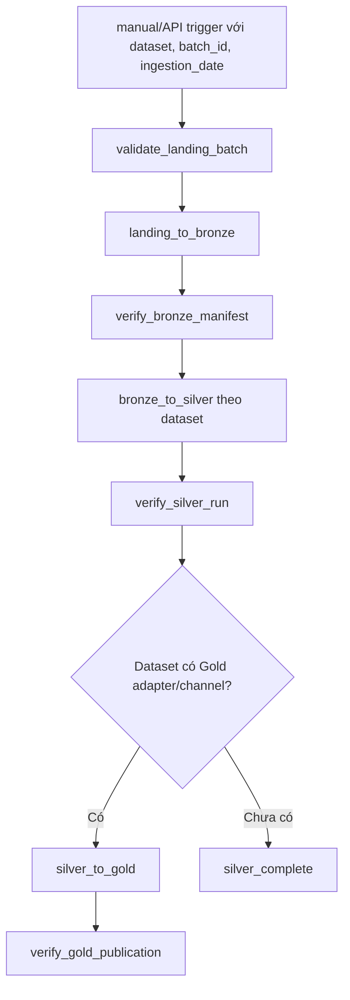
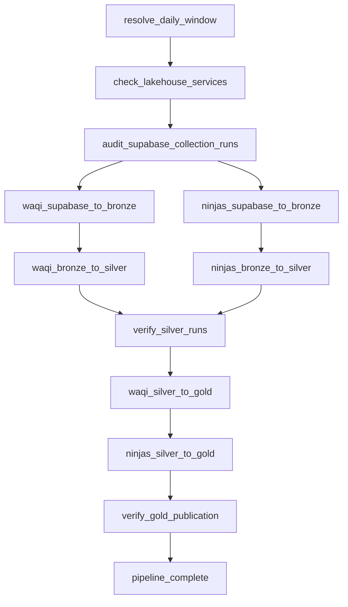

# Airflow orchestration cho hai luồng Lakehouse

[Mục lục tài liệu](../README.md) / **Airflow**

Trạng thái triển khai: hai DAG nằm trong `airflow/dags/`, dùng
`DockerOperator` để chạy đúng image Spark đã được kiểm chứng. DAG mới được tạo
ở trạng thái paused theo mặc định của Airflow; người vận hành kiểm tra import và
trigger thử trước khi unpause lịch daily.

## 1. Mục tiêu và phạm vi

Airflow điều phối hai đường nạp dữ liệu có trigger và contract đầu vào khác
nhau. Hai đường này không phải hai hệ thống ETL riêng: chúng dùng chung Spark,
MinIO, Iceberg/Nessie, Trino, cơ chế kiểm tra và tài nguyên ghi dữ liệu.

```text
Luồng batch lịch sử                    Luồng cloud hằng ngày

Landing files                          Supabase Storage/PostgreSQL
      ↓                                           ↓
MinIO Bronze                           MinIO Bronze
      ↓                                           ↓
Iceberg Silver                         Iceberg Silver
      ↓                                           ↓
Iceberg Gold                           Iceberg Gold
computed/native channels               provider_air_quality
      └───────────────────┬───────────────────────┘
                          ↓
                Trino / FastAPI / Web
```

Airflow không thực hiện transform dữ liệu trong DAG. Mỗi task chỉ xác định đúng
batch/cửa sổ, gọi Spark job hiện có, kiểm tra kết quả và quyết định có cho phép
bước tiếp theo chạy hay không.

Phạm vi orchestration được chia thành hai DAG:

| DAG | Trigger | Mục đích |
| --- | --- | --- |
| `landing_batch_to_gold` | Manual/API, có tham số batch | Nạp file lịch sử hoặc file upload từ Landing |
| `supabase_daily_to_gold` | `30 0 * * *`, Asia/Ho_Chi_Minh | Đồng bộ ngày vừa kết thúc từ Supabase về local |

Không nối hai DAG theo thứ tự Landing rồi Supabase. Chúng là hai entry point độc
lập và chỉ dùng chung hạ tầng/tài nguyên writer. Một DAG lỗi không được làm thay
đổi batch, cửa sổ hoặc publication của DAG còn lại.

## 2. Luồng Landing batch

Luồng này dành cho dữ liệu đã có sẵn trong `data/landing/`, gồm WAQI historical,
CAMS/EAC4, Climate TRACE và dữ liệu hành chính. Đây là batch pipeline, không phải
daily sync và không tự quét lại toàn bộ Landing mỗi đêm.



Tham số tối thiểu của một DAG run:

```text
dataset
batch_id
ingestion_date
bronze_path (được dựng deterministic từ ba giá trị trên)
Gold scope/channel nếu dataset có bước Gold
```

Không nên dùng một `batch_id` ngẫu nhiên mới khi retry. Airflow phải giữ nguyên
tham số của logical run để Bronze có thể verify/reuse batch và Silver có thể bỏ
qua logical run đã thành công.

Thứ tự phụ thuộc hiện tại:

- Hai dataset hành chính phải hoàn tất Silver trước các job cần mapping địa lý.
- WAQI historical, CAMS và Climate TRACE gọi Silver job riêng theo contract.
- Gold không dùng một lệnh chung cho mọi dataset: chọn đúng adapter/channel đã
  được hỗ trợ. Dataset chưa có Gold contract kết thúc hợp lệ tại Silver, không
  được ép vào một fact không cùng grain/semantics.
- Khi import trọn bộ năm dataset hiện có, orchestration có thể dùng một parent
  DAG/TaskGroup, nhưng các Iceberg writer vẫn chạy tuần tự.

`landing_batch_to_gold` nên là DAG manual có cấu hình run thay vì lịch hằng ngày.
Nếu Web/API nhận file upload, hệ thống có thể trigger DAG bằng REST API sau khi
file và manifest hoàn tất; Airflow không theo dõi thư mục bằng vòng lặp polling
liên tục.

## 3. Luồng Supabase cloud hằng ngày

Luồng này đồng bộ một daily micro-batch từ Supabase Cloud về local lakehouse:

```text
Supabase Storage/PostgreSQL
        ↓
MinIO Bronze
        ↓
Iceberg Silver
        ↓
Iceberg Gold, channel provider_air_quality
        ↓
Trino / FastAPI historical reader
```

Phạm vi đầu tiên gồm hai nguồn:

- WAQI live: station provider AQI/IAQI, actual observation time.
- API Ninjas: city-proxy provider AQI, scheduled snapshot time; actual
  observation time không có.

Luồng này không tự biến provider snapshot thành hourly mean, không tính lại
VN_AQI và không mô tả city-proxy là trung bình toàn tỉnh.

### 3.1 Lịch chạy và cửa sổ dữ liệu

DAG đề xuất:

```text
dag_id: supabase_daily_to_gold
timezone: Asia/Ho_Chi_Minh
schedule: 30 0 * * *
catchup: true
max_active_runs: 1
```

DAG chạy lúc 00:30 giờ Việt Nam để collection run 23:00 của ngày vừa kết thúc
có thời gian hoàn tất. Cron 00:30 tạo Airflow data interval từ 00:30 đến 00:30,
không trùng ngày nghiệp vụ. Vì vậy DAG phải chuẩn hóa interval:

```text
window_end_local   = đầu ngày chứa data_interval_end, 00:00 Asia/Ho_Chi_Minh
window_start_local = window_end_local - 1 ngày
window_start_utc   = window_start_local đổi sang UTC
window_end_utc     = window_end_local đổi sang UTC
```

Ví dụ run lúc `2026-10-29 00:30+07` xử lý:

```text
local: [2026-10-28 00:00+07, 2026-10-29 00:00+07)
UTC:   [2026-10-27 17:00Z,      2026-10-28 17:00Z)
```

Không dùng `datetime.now()` để tạo cửa sổ. Retry, manual rerun và catchup của
cùng logical run phải luôn tạo lại đúng window, batch ID và Bronze path.

### 3.2 Task graph



Hai Bronze task ghi hai prefix MinIO độc lập nên có thể chạy song song. Silver
và Gold đều ghi các Iceberg registry/dimension/fact dùng chung; chúng phải dùng
Airflow pool một slot hoặc dependency tuần tự. Phiên bản đầu nên giữ rõ thứ tự:

```text
Silver WAQI → Silver API Ninjas → Gold WAQI → Gold API Ninjas
```

Không chạy đồng thời Silver writer với Gold writer. Gold còn có advisory flock
trong cùng driver, nhưng flock không thay thế Airflow pool hoặc distributed lock.

### 3.3 Chi tiết xử lý từng task

#### 3.3.1 `resolve_daily_window`

Tạo metadata nhỏ, deterministic:

```text
business_date
window_start_utc
window_end_utc
ingestion_date
waqi_batch_id
ninja_batch_id
waqi_bronze_path
ninja_bronze_path
```

Batch ID chỉ dùng ký tự an toàn và phải ổn định theo source/window, ví dụ:

```text
waqi_20261027T170000Z_20261028T170000Z
ninja_20261027T170000Z_20261028T170000Z
```

Bronze path được dựng trước, không tìm batch “mới nhất”:

```text
s3a://lakehouse/bronze/waqi/live/
  ingestion_date=2026-10-29/batch_id=<waqi_batch_id>

s3a://lakehouse/bronze/api_ninjas/province_air_quality/
  ingestion_date=2026-10-29/batch_id=<ninja_batch_id>
```

XCom chỉ chứa các chuỗi điều phối nhỏ này; không đưa raw payload, credential,
Spark DataFrame hoặc danh sách observation vào Airflow metadata database.

#### 3.3.2 `check_lakehouse_services`

Fail sớm nếu thành phần bắt buộc chưa sẵn sàng:

- Docker API proxy nhận request từ Airflow.
- MinIO health endpoint trả thành công.
- Nessie API v2 hoạt động.
- Trino trả `/v1/info`.
- Supabase PostgreSQL/Storage có thể truy cập bằng secret của task.

Health check chỉ đọc, không bootstrap/xóa dữ liệu và không coi một service
container ở trạng thái `running` là đủ nếu endpoint chưa healthy.

#### 3.3.3 `audit_supabase_collection_runs`

Query `public.collection_runs` theo `[window_start_utc, window_end_utc)` cho
hai source. Với collector mỗi giờ, kỳ vọng 24 distinct `scheduled_hour_utc` cho
mỗi source. Mỗi hour phải có ít nhất một attempt terminal `succeeded` hoặc
`partial` và manifest metadata hợp lệ.

Quy tắc:

- `partial` được phép đi tiếp; coverage/invalid records được giữ trong QC.
- Mặc định cho phép thiếu tối đa một collection hour/source/ngày; giờ thiếu được
  log/XCom như coverage warning và không tạo observation giả.
- Thiếu quá `AIRFLOW_SUPABASE_MAX_MISSING_HOURS` phải fail thay vì âm thầm đóng
  một ngày có coverage thấp. Đặt biến này bằng `0` để quay lại chính sách 24/24.
- `running` quá hạn hoặc chỉ có `failed` phải được báo lỗi.
- Audit không gọi lại provider API để “tái tạo” dữ liệu quá khứ.

Task có thể retry đến deadline vận hành, ví dụ 02:00 giờ Việt Nam. Sau deadline,
DAG fail và cần reconciliation/backfill khi raw object đã có.

#### 3.3.4 Supabase → Bronze

Mỗi source gọi:

```text
spark/jobs/bronze/supabase_to_bronze.py
  --source <waqi|api_ninjas>
  --window-start <UTC>
  --window-end <UTC>
  --batch-id <stable ID>
  --ingestion-date <stable date>
```

Job chọn succeeded/partial collection runs, tải manifest/raw objects, kiểm tra
SHA-256, ghi immutable files, `_file_metadata`, `_ingestion_manifest/_SUCCESS`
và checkpoint. Task thành công chỉ khi batch đọc lại được và `_SUCCESS` tồn tại.

Retry semantics:

- Batch đã hoàn tất và fingerprint giống nhau: verify rồi success.
- Cùng batch ID nhưng fingerprint khác: fail, không overwrite.
- Không có eligible collection run: fail; không tạo batch rỗng.

#### 3.3.5 Bronze → Silver

Mỗi source gọi:

```text
spark/jobs/silver/supabase_bronze_to_silver.py
  --source <waqi|api_ninjas>
  --bronze-path <exact path from resolve_daily_window>
```

WAQI ghi station/hourly observations và pollutant IAQI. API Ninjas ghi
city-proxy locations, hourly observations và measurement rows. Silver chỉ dùng
successful ingestion lineage; logical run đã succeeded sẽ được skip khi replay.

Sau cả hai job, `verify_silver_runs` kiểm tra:

- đúng batch ID có `ingestion_run.status='succeeded'`;
- không lấy rows từ failed attempt;
- không có fatal `data_quality_issue`;
- output row count lớn hơn 0;
- API Ninjas proxy mapping vẫn tham chiếu admin version hợp lệ.

#### 3.3.6 Silver → Gold

Mỗi source gọi:

```text
spark/jobs/gold/supabase_live.py
  --source <waqi|api_ninjas>
  --schema gold
  --silver-schema silver
  --start-date <business_date>
  --end-date <business_date + 1, exclusive>
  --channel provider_air_quality
```

Gold pin Silver snapshots trước khi ghi. Adapter materialize:

```text
dim_location
dim_air_quality_series
dim_metric
bridge_source_variable_metric
fact_aqi_hourly
fact_aqi_pollutant_hourly
mart_air_quality_hourly
mart_source_quality_daily
```

WAQI và API Ninjas dùng chung physical AQI facts thông qua `series_id`, nhưng
không cùng semantic identity:

| Thuộc tính | WAQI | API Ninjas |
| --- | --- | --- |
| Location kind | `station` | `city_proxy` |
| Profile | `station_reference` | `proxy_estimate` |
| Actual observation clock | Có | NULL |
| Scheduled snapshot clock | NULL | Có |
| AQI origin | `provider` | `provider` |

Gold validation chạy trước publication. Release/pointer/timeline chỉ cập nhật
sau khi keys, origin, provider scheme, clocks, row counts và location semantics
đạt contract. Hai source được publish thành hai compatibility lane trong channel
`provider_air_quality`; không thay pointer `air_quality` của computed VN_AQI.

#### 3.3.7 `verify_gold_publication`

Trino quality gate tối thiểu:

```text
- gold_release có release thuộc đúng scope/channel;
- gold_timeline_current có channel provider_air_quality;
- timeline có WAQI và API Ninjas lane cho scope;
- fact_aqi_hourly có aqi_origin=provider;
- WAQI observed_at_utc có giá trị;
- API Ninjas observed_at_utc NULL và scheduled_at_utc có giá trị;
- mart rows khớp fact pollutant rows;
- historical reader trả không có missing scope cho từng source.
```

Task không đọc table head tùy ý để kết luận publish thành công; phải resolve
release/timeline snapshot mappings đã publish.

## 4. Thành phần dùng chung giữa hai DAG

Hai DAG nên tái sử dụng code orchestration, không copy toàn bộ operator:

- factory/helper submit Spark với cấu hình JAR, memory và connection thống nhất;
- health check MinIO, Nessie, Spark và Trino;
- TaskGroup kiểm tra Bronze manifest, Silver succeeded run và Gold publication;
- logging, alert, timeout, retry callbacks và Airflow Connections/Secrets;
- pool `iceberg_writer` một slot cho mọi Silver/Gold writer của cả hai DAG.

`bronze_sync` có thể cho phép hai Supabase source chạy song song. Landing Bronze
đọc disk và Supabase Bronze đọc cloud nên vẫn cần giới hạn theo tài nguyên local;
không cho hai DAG vô tình vượt memory/I/O chỉ vì chúng có schedule khác nhau.

## 5. Idempotency và retry theo layer

| Layer | Identity khi retry | Kết quả mong đợi |
| --- | --- | --- |
| Airflow | DAG logical run + batch hoặc business window | Không đổi identity đầu vào |
| Bronze | source + UTC window + stable batch ID + fingerprint | Verify/reuse batch |
| Silver | dataset + batch + pipeline/version | Skip succeeded logical run |
| Gold | pinned Silver snapshots + scope + contract + code hash | `GOLD_REPLAY` hoặc `GOLD_PROVIDER_REPLAY` |
| Timeline | release ID + compatible scope/lane | Không thêm duplicate segment |

Nếu Silver snapshot thay đổi do correction hợp lệ, Gold tạo release mới cho cùng
scope và timeline overlay thay scope cũ trong đúng compatibility lane. Release
cũ vẫn bất biến để rollback; Airflow không xóa snapshot hoặc sửa pointer bằng SQL.

## 6. Failure và recovery

| Điểm lỗi | Hành vi |
| --- | --- |
| Landing thiếu file/manifest | Không tạo Bronze batch; sửa đầu vào rồi chạy lại cùng cấu hình |
| Audit thiếu trong ngưỡng cấu hình | Tiếp tục, ghi coverage warning, không tạo dữ liệu giả |
| Audit thiếu quá ngưỡng | Không chạy Bronze; retry/fail có cảnh báo |
| Bronze checksum/fingerprint lỗi | Không chạy Silver của source |
| Silver failed sau khi đã ghi một phần | Consumer bỏ qua vì run không succeeded |
| Dataset Landing chưa có Gold adapter | Kết thúc tại Silver; không ép publish vào Gold |
| Một Silver source fail | Không publish Gold ngày đó |
| Gold validation fail | Không cập nhật timeline pointer |
| WAQI Gold publish, Ninjas Gold fail | DAG fail; WAQI release vẫn hợp lệ, retry hoàn tất Ninjas |
| Airflow/local tắt nhiều ngày | `catchup=true`, chạy từng daily window tuần tự |

Không dùng `depends_on_past=True` ở mức bắt buộc nếu muốn một ngày lỗi không
chặn toàn bộ ngày sau. Thay vào đó giữ coverage audit và một reconciliation DAG
hoặc manual backfill cho missing windows. `max_active_runs=1` ngăn các daily run
ghi chồng nhau trên máy local.

## 7. Pools, timeout và retry policy

Thiết lập ban đầu phù hợp stack local:

```text
pool bronze_sync:       2 slots
pool iceberg_writer:    1 slot
max_active_runs:        1
Bronze retries:         2, delay 10 phút
Silver retries:         1, delay 10 phút
Gold retries:           1, delay 10 phút
task execution timeout: theo benchmark, không để vô hạn
```

Bronze có thể dùng hai slot. Tất cả Silver/Gold task dùng `iceberg_writer` một
slot. Không tăng concurrency trước khi đo memory/driver/task size trên hardware
thực tế.

## 8. Cách Airflow chạy Spark

Implementation dùng `DockerOperator` và image
`air-quality-spark:3.5.4-iceberg-1.7.1`. Mỗi task tạo một container ngắn hạn,
chạy `spark-submit --master local[1]`, tham gia `lakehouse-net`, rồi tự xóa khi
thành công. Cách này giữ nguyên Java, ecCodes, Python packages và Iceberg JARs
đã được kiểm chứng; đặc biệt không tạo một runtime CAMS thứ hai trong image
Airflow.

Các source sau được mount read-only bằng named bind volume:

```text
spark/jobs       → /opt/spark/work-dir/jobs
spark/config     → /opt/spark/conf
lakehouse/silver → /opt/spark/work-dir/lakehouse/silver
lakehouse/gold   → /opt/spark/work-dir/lakehouse/gold
data/landing     → /opt/spark/work-dir/landing
```

Airflow không nhận trực tiếp `/var/run/docker.sock`. Service `docker-proxy` là
thành phần duy nhất mount socket và chỉ xuất Docker API trên network internal
`docker-api-net`. Vì API vẫn cho phép tạo container, đây vẫn là quyền cao trên
host và chỉ phù hợp deployment local tin cậy; không mở port proxy ra host/LAN.
Proxy image local tăng HAProxy client/server idle timeout lên 12 giờ để request
`POST /containers/{id}/wait` của DockerOperator sống lâu bằng Spark task. Timeout
HTTP request/connect vẫn giữ ngắn; Airflow `execution_timeout` vẫn giới hạn task.

Supabase Bronze retry từng Storage object tối đa 5 lần với backoff 1/2/4/8 giây
cho lỗi transport và HTTP 408/429/5xx. HTTP auth/not-found và checksum mismatch
vẫn fail ngay. Log tiến độ theo từng collection run để phân biệt tải chậm với
task bị treo.

Airflow pool là single-writer control trong deployment local. Nếu chuyển sang
Celery/Kubernetes hoặc nhiều host, advisory file lock hiện tại không còn đủ;
cần distributed writer lock/fencing hoặc chuyển transport phù hợp nền tảng.

### 8.1 Khởi động và kiểm tra DAG

Chạy từ repository root để `${PWD}` của các named bind volume trỏ đúng project:

```bash
docker compose build spark-master spark-worker airflow-init airflow-webserver airflow-scheduler
docker compose up -d docker-proxy postgres minio minio-init nessie trino
docker compose up -d airflow-init
docker compose up -d airflow-webserver airflow-scheduler

docker compose exec -T airflow-scheduler airflow dags list-import-errors
docker compose exec -T airflow-scheduler airflow dags list
docker compose exec -T airflow-scheduler airflow pools list
```

Kỳ vọng không có import error và có hai pool `bronze_sync=2`,
`iceberg_writer=1`.

### 8.2 Trigger Landing batch

Ví dụ chỉ chạy đến Silver:

```bash
docker compose exec -T airflow-scheduler airflow dags trigger \
  landing_batch_to_gold \
  --conf '{"dataset":"waqi/historical","batch_id":"waqi-history-20261028","ingestion_date":"2026-10-28","publish_gold":false}'
```

Ví dụ CAMS chạy tiếp Gold production:

```bash
docker compose exec -T airflow-scheduler airflow dags trigger \
  landing_batch_to_gold \
  --conf '{"dataset":"CAMS/EAC4","batch_id":"cams-20261028","ingestion_date":"2026-10-28","publish_gold":true,"gold":{"dataset_id":"REPLACE_WITH_VERIFIED_SILVER_DATASET_ID","start_date":"2026-01-01","end_date":"2026-01-02","allow_validation":false}}'
```

Không dùng dataset ID minh họa. Lấy ID từ successful Silver run đã kiểm tra.
Với `waqi/historical` hoặc `climate_trace/climate_trace_vietnam`, đặt
`publish_gold=true` sẽ gọi nhánh Gold `native_sources`. Job native hiện đọc cả
WAQI historical và Climate TRACE; chỉ bật sau khi các bảng Silver của cả hai
family đã tồn tại và có successful lineage.

### 8.3 Bật daily Supabase

`AIRFLOW_SUPABASE_START_DATE` xác định ngày bắt đầu catchup và mặc định là
`2026-10-27`. Đặt lại trong `.env` trước khi khởi tạo scheduler nếu không muốn
backfill từ ngày này. Sau khi test một logical date và kiểm tra Gold:

```bash
docker compose exec -T airflow-scheduler airflow dags unpause supabase_daily_to_gold
```

Không unpause khi Supabase chưa có đủ 24 manifested collection hours/source cho
ngày đầu tiên; audit sẽ chủ động fail thay vì tạo batch thiếu.

## 9. Credentials và logging

Credential Supabase/MinIO chỉ đi qua Airflow Connection, environment hoặc secret
backend. Không đưa service-role key, JDBC password, raw manifest hay signed URL
vào DAG code, XCom hoặc log.

Tên environment hiện tại `AWS_CONNECTION_STRING`/`AWS_SECRET_KEY` đang được job
Supabase sử dụng như JDBC/service credential và dễ gây nhầm. Khi triển khai DAG
nên migrate có kiểm soát sang tên rõ nghĩa như:

```text
SUPABASE_DB_JDBC_URL
SUPABASE_SERVICE_ROLE_KEY
```

Trong thời gian tương thích, job có thể đọc tên mới trước rồi fallback tên cũ;
không đổi secret name giữa một daily run.

Mỗi task log các identity không nhạy cảm:

```text
dag_run_id, source, business_date, window, batch_id, bronze_path,
Silver logical/run ID, Gold release ID, row counts, status, elapsed time
```

## 10. Backfill và reconciliation

Với Landing, backfill được xác định bởi `dataset + ingestion_date + batch_id`.
Chỉ trigger những batch đã có file hoàn chỉnh; retry giữ nguyên ba tham số. Nếu
cần nạp lại nội dung đã sửa, tạo batch ID mới thay vì ghi đè batch bất biến cũ.

Với Supabase, backfill dùng cùng daily logical window, không gom tùy ý nhiều ngày
vào một Bronze batch. Chạy tuần tự từ ngày cũ đến mới để timeline và resource
usage dễ kiểm soát.

Trước backfill:

1. Kiểm tra Supabase còn raw manifest/object cho toàn window.
2. Đối chiếu 24 collection hours/source.
3. Chạy thử một ngày.
4. Theo dõi MinIO capacity, Spark memory và timeline segment count.

Reconciliation định kỳ so sánh cả hai đường:

```text
Landing file/manifest
↔ Landing Bronze completed batch
↔ Silver succeeded logical run
↔ Gold publication nếu dataset có Gold contract

Supabase eligible scheduled hours
↔ Bronze completed batches
↔ Silver succeeded logical runs
↔ Gold published timeline scopes theo source
```

Sai lệch tạo alert/report; không tự xóa raw, expire Iceberg snapshot hoặc tạo dữ
liệu provider thay thế.

## 11. Điều kiện nghiệm thu hai DAG

Điều kiện chung:

- Airflow → Spark transport và network callback đã chạy smoke/integration test.
- Một task fail không cập nhật sai Gold pointer.
- Hai DAG dùng chung `iceberg_writer` và không chạy đồng thời Silver/Gold writer.
- Secret không xuất hiện trong rendered task/log/XCom.

Điều kiện cho `landing_batch_to_gold`:

- Trigger manual/API yêu cầu dataset, ingestion date và stable batch ID.
- Retry cho kết quả Bronze verify, Silver skip và Gold replay nếu có Gold step.
- Dataset chưa có Gold adapter kết thúc tại Silver với trạng thái rõ ràng.
- Import nhiều dataset vẫn tôn trọng thứ tự dependency hành chính và writer pool.

Điều kiện cho `supabase_daily_to_gold`:

- Cùng daily run retry cho kết quả Bronze verify, Silver skip và Gold replay.
- Tắt scheduler rồi bật lại tạo đúng catchup windows.
- Hai source xuất hiện trong `provider_air_quality` timeline đúng scope.
- API Ninjas actual observation clock vẫn NULL; WAQI actual clock vẫn có.
- Có query/alert cho missing collection hours và failed DAG runs.
- Gold giữ giờ thiếu là khoảng trống; không nội suy hoặc thay bằng AQI `0`.

Sau khi đạt các điều kiện tương ứng mới bật DAG production. Lệnh ETL thủ công và
truy vấn kiểm tra hiện có tại [RUN](../operations/RUN.md); chi tiết file batch tại
[Landing → Bronze](../lakehouse/landing-to-bronze.md), source contract cloud tại
[Supabase pipeline](../supabase/supabase-to-lakehouse-plan.md) và kết quả Gold tại
[Gold](../lakehouse/GOLD.md).
