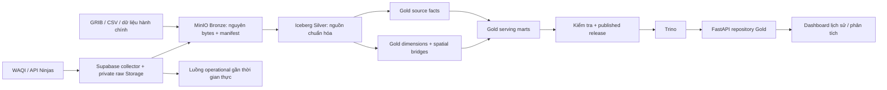

# Kế hoạch xây dựng lớp Gold

Ngày rà soát: **27/10/2026**. Trạng thái: **kế hoạch triển khai**, chưa tạo bảng, chạy ETL Gold hoặc sửa Supabase.

Đề xuất: xây Gold bằng **Iceberg trên MinIO, cùng Nessie catalog hiện tại**, tách các fact theo nguồn và grain; dùng dimension hành chính, metric và thời gian chung. FastAPI đọc các mart đã công bố qua Trino. Supabase tiếp tục thu thập và phục vụ dữ liệu vận hành gần thời gian thực. Không cần đưa toàn bộ Gold trở lại Supabase để bắt đầu.

## 1. Căn cứ và giới hạn kiểm chứng

Ưu tiên code/schema hiện tại khi tài liệu cũ khác với implementation. Bằng chứng được lưu trong [gold-source-review.json](gold-source-review.json); truy vấn GET và phép kiểm tra file nằm trong [scripts/review_gold_sources.py](../scripts/review_gold_sources.py).

| Thành phần | Đã đọc/kiểm tra | Kết luận cho Gold |
| --- | --- | --- |
| Hạ tầng | `docker-compose.yml`, Spark defaults, Trino catalog, Spark Dockerfile | Spark 3.5.4, Iceberg 1.7.1, Nessie 0.104.5, Trino 476; Spark `nessie`, Trino `iceberg`, cùng branch `main` và bucket `lakehouse` |
| Runtime | Dockerfile và requirements | Image Spark dùng Java 11 và Python 3.8; README gốc còn ghi Java 17. Khi bổ sung thư viện Gold phải kiểm tra runtime thực tế |
| Bronze | Hai job trong `spark/jobs/bronze/` | File gốc bất biến, sidecar SHA-256, chỉ nhận batch có `_ingestion_manifest/_SUCCESS`; Bronze hiện là raw files, không phải bảng Iceberg |
| Silver | `lakehouse/silver/silver.sql`, năm job và `common.py` | Có schema và pipeline cho CAMS, hành chính, WAQI, Climate TRACE, Supabase live; cần lọc đúng successful ingestion attempt |
| Gold và lịch ETL | `lakehouse/gold/`, `airflow/dags/` | Mới có placeholder, chưa có job/schema/DAG Gold |
| Backend | repository factory, schema API, ETL mẫu, temporal service | Chỉ có repository Parquet; dữ liệu mẫu không phải Gold chính thức |
| Supabase cloud | REST GET vào hai danh mục, collection runs, snapshot counts và Storage bucket | Truy cập đọc thành công; kết quả bên dưới là dữ liệu thực tại thời điểm rà soát |
| Iceberg đang lưu | `docker compose ps -a` | Không trả container của project trong Docker context hiện tại; chưa truy vấn trực tiếp MinIO/Nessie/Silver, chưa xác nhận full CAMS backfill |

Không suy diễn rằng Silver đã hoàn chỉnh chỉ từ schema hoặc kết quả test trong README. Các số Silver từng được kiểm chứng ngày 26/10 là bằng chứng lịch sử; giai đoạn 0 phải kiểm tra lại khi stack chạy.

### 1.1. Dữ liệu Landing thực tế

| Nguồn | Hiện có | Phạm vi được kiểm chứng lần này |
| --- | --- | --- |
| CAMS EAC4 | 20 GRIB, khoảng 2,62 GB | Đếm file/kích thước; chưa giải mã lại toàn bộ GRIB. Theo contract: 20 biến, lưới 23 × 25, 575 điểm, native 3 giờ; archive 2003–2025 |
| WAQI lịch sử | 17 CSV, **29.725 dòng** | Đọc CSV; ngày sớm nhất 01/01/2014, muộn nhất 12/09/2026; mỗi trạm có thời đoạn và cột khác nhau |
| Climate TRACE | 3 CSV, **61.818 dòng** | 1.440 dòng tổng hợp năm 2015–2020; 15.840 dòng tổng hợp tháng 01/2021–06/2026; 44.538 dòng source observation mang nhãn năm 2026 |
| Hành chính | 11 file nguồn Open Admin + 3.363 file nguồn provinces database | Cả hai danh mục có 34 tỉnh; 3.355 GeoJSON gồm cả cấp dưới. Snapshot metadata lần lượt 08/09 và 12/09/2026 |
| ERA5 | Thư mục rỗng | Chưa đưa vào phạm vi Gold |

Climate TRACE source CSV có **12.154 dòng trùng hoàn toàn**, còn 32.384 dòng phân biệt. Sau bỏ trùng có **2.579 dòng `point-source`** và **29.805 dòng `gadm-aggregation`**. Đây là số dòng observation theo gas, không phải số cơ sở duy nhất. Ba gas đang có: `co2`, `pm2_5`, `so2`.

Backend sample manifest đang trỏ tới **36 vùng báo cáo**, do tách phần đất liền và hai vùng quần đảo; không được dùng số này làm số tỉnh hành chính. Mẫu hiện tại và API dùng lịch UTC; Silver hiển thị timestamp theo `Asia/Ho_Chi_Minh`.

### 1.2. Supabase thực tế lúc 20:50 giờ Việt Nam, 27/10/2026

| Hạng mục | Kết quả GET |
| --- | --- |
| `waqi_stations` | 31 trạm, cả 31 active, có tọa độ |
| `api_ninjas_locations` | 34 location, cả 34 active, có tọa độ |
| WAQI collection runs | 55 run trong phạm vi truy vấn, tất cả `partial`; mới nhất giờ logic 13:00 UTC, thành công 29/31 target |
| API Ninjas collection runs | 57 run trong phạm vi truy vấn, tất cả `succeeded`; mới nhất 13:00 UTC, thành công 34/34 target |
| `waqi_snapshots` | Count tại thời điểm đọc: 1.705 collection snapshots; không đồng nghĩa 1.705 logical observations hợp lệ |
| `api_ninjas_snapshots` | Count tại thời điểm đọc: 1.938 collection snapshots |
| Manifest | Không có run completed bị thiếu path/hash manifest trong các run đã đọc; chưa tải và hash lại object |
| Bucket `raw-api` | `public=false` |

Các count là ảnh chụp trong lúc collector tiếp tục chạy, không phải một transaction chung. Chưa đọc trực tiếp `cron.job`, RLS policies, Vault hoặc source Edge Function đang deploy. Tài liệu mô tả WAQI phút 00, API Ninjas phút 05; snapshot đọc được có giờ thu thập gần phút 00, nên phải đối chiếu Cron thực tế trước khi chốt lịch/SLA.

## 2. Những quyết định nên chốt ngay

1. **Gold là analytical layer trên Iceberg.** Không dùng PostgreSQL metadata của Airflow làm warehouse. Không đọc Supabase snapshots trực tiếp rồi gọi đó là Gold.
2. **Conformed dimensions, facts riêng theo grain.** CAMS area estimate, WAQI station observation, API Ninjas city proxy và phát thải không được nối raw facts nhiều-nhiều hoặc trộn thành một số đo.
3. **MVP ưu tiên CAMS theo tỉnh + API Ninjas theo điểm đại diện + chất lượng/freshness.** WAQI giữ ở grain trạm trước, Climate TRACE triển khai sau khi chốt đơn vị và ý nghĩa không gian.
4. **Lịch UTC giữ tương thích API cũ.** Gold lưu UTC instant; các mart ngày/tháng ghi `calendar_timezone` trong khóa. Có thể bổ sung lịch Việt Nam, nhưng API phải công bố lựa chọn đó rõ ràng.
5. **Ranh giới hiện tại là reporting geography.** Tổng hợp CAMS 2003–2025 theo snapshot hành chính 2026 phải được ghi là lịch sử quy về ranh giới snapshot này; không gán snapshot date thành ngày hiệu lực pháp lý.
6. **Provider AQI và nồng độ tách riêng.** Chưa tính VN_AQI từ CAMS trong MVP. Giữ scheme/provider của AQI; không tự áp cùng nhãn sức khỏe cho hai provider.
7. **Chỉ công bố release đã qua kiểm tra.** Việc một bảng Iceberg commit thành công không có nghĩa cả tập bảng Gold đã sẵn sàng.



## 3. Khoảng trống cần xử lý trước khi công bố

| Ưu tiên | Phát hiện | Việc cần làm |
| --- | --- | --- |
| P0 | Chưa xác nhận CAMS standard đủ toàn bộ archive | Đếm theo dataset/version, successful run, min/max time, gap/duplicate, 20 array lengths; loại dataset `EAC4-validation-*`. Không dùng native legacy cube |
| P0 | API Ninjas `value_standard` và unit nồng độ đang NULL | Provider hiện công bố cả sáu nồng độ theo **µg/m³**. Lưu bằng chứng unit policy; migration metadata và backfill standard có kiểm soát trước khi mart nồng độ dùng nguồn này |
| P0 | WAQI live chưa map tỉnh; historical thiếu native station UID/tọa độ | Tạo bridge kiểm chứng; giữ unmatched. Không gộp CSV historical với live chỉ vì tên giống nhau |
| P0 | Source runs `partial` khác Silver run `succeeded` | Cho phép observation hợp lệ từ source run partial nếu normalization thành công; giữ coverage và số invalid từ manifest. Không loại hết WAQI vì source partial |
| P0 | Climate TRACE units chưa xác nhận trong Silver | Chưa đặt tên `emission_tonnes`; giữ native quantity với unit chưa xác nhận, chặn metric có đơn vị chuẩn đến khi có release metadata gốc |
| P0 | `gadm-aggregation` không phải cơ sở phát thải tại một điểm | Tách với `point-source`; không spatial join centroid rồi gọi là tổng phát thải tỉnh. Cần vùng GADM gốc/crosswalk hoặc giữ riêng chưa phân bổ |
| P1 | 34 tỉnh và 36 reporting regions không cùng grain | Có dimension vùng báo cáo/parent; không cộng đồng thời tỉnh đầy đủ và các phần con |
| P1 | Chưa có checkpoint lịch chạy/DAG đầy đủ | Xây sync và orchestration cùng Gold; `_SUCCESS` chứng minh một batch hoàn tất, chưa chứng minh toàn bộ các cửa sổ đã được đồng bộ |
| P1 | Code/tài liệu khác nhau về timestamp API Ninjas | Theo code: `snapshot_hour_utc` lấy từ manifest scheduled hour. Sửa README Silver đoạn còn hướng dẫn truncate collection time |

Đơn vị API Ninjas được xác nhận từ [tài liệu provider](https://api-ninjas.com/api/airquality), không suy từ độ lớn giá trị. Migration cần thay cả variable metadata và measurement standard: `merge_checked` hiện từ chối đổi unit, còn successful run cùng pipeline version sẽ skip. Chỉ tăng version rồi chạy lại là chưa đủ; cần migration riêng, backfill từ Bronze/Silver native đã kiểm chứng, kiểm tra `value_standard = value_native` cho sáu concentration variables và bảo toàn lineage/hash. Dữ liệu AQI không bị đổi đơn vị theo migration này.

## 4. Mô hình Gold đề xuất

Namespace Spark: `nessie.gold`; Trino: `iceberg.gold`. Namespace và từng bảng phải có `LOCATION` rõ dưới `s3a://lakehouse/gold/`; kiểm tra vị trí thực tế thay vì coi schema tự bảo đảm prefix vật lý. Iceberg format v2, Parquet + Zstd. Mọi khóa trong bảng dưới đây là logical constraints do ETL kiểm tra.

### 4.1. Dimensions và mapping

| Bảng đề xuất | Khóa/grain | Nội dung |
| --- | --- | --- |
| `dim_admin_unit` | `admin_unit_version_id` | Tên, mã, parent, level, snapshot, hiệu lực nếu có; không chỉ giữ tên hiện hành |
| `dim_reporting_region` | `reporting_region_id` | Tỉnh đầy đủ, mainland hoặc archipelago; parent admin version, geometry hash, reporting policy version |
| `dim_metric` | `metric_id` | Canonical pollutant, measurement kind, unit, physical quantity, vertical support, AQI scheme, aggregation policy version |
| `bridge_source_variable_metric` | `dataset_id, variable_id, metric_policy_version` | Mapping source variable sang metric; alias `pm2p5`/`pm25`/`pm2_5`; provider và phương pháp giữ riêng |
| `dim_date` | `calendar_date` | Ngày/tháng/quý/năm, số ngày thực tế; fact chỉ rõ calendar timezone |
| `dim_station` | `station_id` | WAQI identity, tọa độ, metadata status; alias nối qua Silver source mapping |
| `dim_proxy_location` | `dataset_id, proxy_location_id` | Query city, query point, admin version, city_proxy, phương pháp mapping |
| `dim_emission_source` | `dataset_id, source_id` | Source type, sector, subsector, asset type, tọa độ và unit metadata |
| `bridge_station_admin` | `station_id, geography_policy_version, mapping_valid_from` | Admin version, thời đoạn mapping, method, trạng thái kiểm chứng; unmatched là trạng thái hợp lệ |
| `bridge_cams_region_weight` | `grid_id, grid_point_id, reporting_region_id, boundary_hash, method_version` | Diện tích giao cell–region, diện tích region, raw area fraction, grid coverage; khóa version geometry/method rõ ràng |
| `bridge_emission_source_region` | `dataset_id, source_id, reporting_region_id, allocation_method_version` | Point assignment hoặc regional crosswalk; có allocation weight và mapping status, không dùng chung hai thuật toán |

Một metric có cùng pollutant nhưng khác `measurement_kind`, đơn vị, AQI scheme hoặc vertical support là metric khác. CAMS `co/no2/o3/so2` là nồng độ ở model level 60; không đổi nhãn thành phép đo mặt đất tại trạm. `*_column` vẫn là mg/m²; PM1 không trở thành thành phần AQI.

### 4.2. Fact và serving mart

| Bảng đề xuất | Grain/khóa logic chính | Partition ban đầu |
| --- | --- | --- |
| `fact_cams_region_3h` | dataset, grid, region, UTC valid_time, metric, spatial policy | `year(valid_time)`; pilot quyết định có cần tháng |
| `fact_waqi_station_observation` | dataset, station, source observation time | `month(observation_time_utc)` |
| `fact_waqi_station_measurement` | observation identity, metric | `month(observation_time_utc)` |
| `fact_waqi_station_daily_native` | dataset, station, local observation_date, metric | `year(observation_date)` |
| `fact_proxy_observation_hourly` | dataset, proxy location, scheduled UTC hour | `month(snapshot_hour_utc)` |
| `fact_proxy_measurement_hourly` | proxy observation identity, metric | `month(snapshot_hour_utc)` |
| `fact_emission_national_period` | dataset, country, period type/start, hierarchy level, sector/subsector, gas metric | `year(period_start)` |
| `fact_emission_source_annual` | dataset, source, year, gas metric | `year(period_start)` |
| `mart_cams_region_daily` | dataset, grid, region, date, timezone, metric, aggregation policy | `year(period_start)` |
| `mart_cams_region_monthly` | dataset, grid, region, month start, timezone, metric, aggregation policy | `year(period_start)` |
| `mart_proxy_daily` | dataset, proxy, date, timezone, metric, aggregation policy | `year(period_start)` |
| `mart_waqi_station_daily_derived` | dataset, station, date, timezone, metric, derivation policy | `year(period_start)` |
| `mart_emission_region_annual` | dataset, region, year, gas, sector/subsector, source type, allocation policy | `year(period_start)` |
| `mart_source_quality_daily` | source/dataset, day, metric hoặc target scope, policy | `month(period_start)` |

Giữ source metric ID/variable ID, source dataset ID, source ingestion run ID, UTC timestamps, QC, missing reason, mapping policy và `gold_build_id` phù hợp trên fact. Header chứa provider overall AQI; không trộn overall AQI vào pollutant measurement không có định danh riêng. Mart tổng hợp giữ `sum_value`, `valid_sample_count`, `expected_sample_count`, coverage và phạm vi input để có thể tính lại.

Không bắt buộc sao chép toàn bộ Silver qua Gold: fact nào chưa có transform, mapping hoặc contract phục vụ riêng có thể bắt đầu bằng query adapter từ input snapshot đã pin. Materialize các bảng cần cho API, kiểm tra và hiệu năng; danh sách trên là đích triển khai theo từng giai đoạn.

## 5. Quy tắc biến đổi

### 5.1. CAMS: cube → vùng báo cáo

- Chỉ đọc `cams_cube_standard`, join `ingestion_run.status='succeeded'` trong cùng tập snapshot input. Kiểm tra batch/source provenance; không rescale lần nữa.
- Giữ nguyên thứ tự `cams_grid_point.grid_point_id` bắt đầu từ 0. Trong Trino subscript là `grid_point_id + 1`. Kiểm tra array length bằng số điểm lưới.
- Xây cell từ grid center và increments đã kiểm chứng; tính giao polygon trong CRS bằng diện tích. Có thể chuyển thuật toán từ `backend/app/etl/spatial.py`, nhưng input phải là Silver grid/boundary, không đọc lại Landing để tạo Gold.
- Khởi đầu bằng 34 tỉnh đầy đủ. Chế độ 36 reporting regions là policy riêng gồm các phần không chồng lặp; không trộn hai chế độ trong một tổng.
- Dùng raw area fraction `w_i = intersection_area_i / region_area`, **không chỉ dùng normalized weights**, để không che thiếu coverage ngoài miền lưới.

```text
valid_area_fraction(t) = Σ w_i trên cell có giá trị hợp lệ
region_value(t) = Σ(w_i × x_i(t)) / valid_area_fraction(t)
```

Mặc định đề xuất: coverage không gian ít nhất **0,95**, kế thừa convention mẫu hiện có. Dưới ngưỡng: output NULL kèm `insufficient_spatial_coverage`; không nearest-cell fallback và không fill zero. Nếu grid không phủ đủ vùng, báo thiếu, không chuẩn hóa thành 100%.

Chỉ explode array theo phạm vi thời gian/metric đang xử lý hoặc dùng phép nhân ma trận theo chunk. Không explode toàn archive × 20 biến rồi cross join mọi polygon. Cache bridge weights theo grid/geometry/method hash. Bổ sung thư viện phép chiếu diện tích phù hợp Python 3.8 hoặc môi trường job riêng; container hiện chưa liệt kê `pyproj`.

### 5.2. Tổng hợp thời gian

- Gold lưu UTC instant; daily/monthly key chứa `calendar_timezone`. API cũ mặc định UTC. Khi thêm lịch Việt Nam, trả metadata và không đổi âm thầm đường biên ngày.
- CAMS full day kỳ vọng 8 native timestamps, không lấy số điểm đang có làm mẫu số. Ngày đầu/cuối archive hoặc selection bị cắt phải đánh dấu partial.
- Convention khởi đầu: daily hợp lệ từ **6/8 mẫu** đã qua spatial QC. Monthly yêu cầu ít nhất **75% ngày đủ điều kiện** và **75% native samples kỳ vọng**; lưu riêng coverage trước và sau loại ngày không đủ điều kiện. Đây là policy phân tích, không phải tiêu chuẩn AQI.
- Monthly tính từ tổng/count của các mẫu thuộc ngày đủ điều kiện; không lấy trung bình của các daily means có số mẫu khác nhau. Annual cũng dùng tổng/count phù hợp, kèm coverage cả năm; không lấy trung bình các monthly means thiếu trọng số.
- Proxy ngày kỳ vọng 24 logical collection hours cho location active đủ ngày. Tách `collection_hour_coverage` khỏi thời gian quan trắc: API Ninjas không cung cấp observation timestamp.
- WAQI dùng observation time thật. Với feed thời gian không tròn giờ, định nghĩa hour-slot và chọn record trong slot bằng quy tắc deterministic trước khi tính coverage; không đếm nhiều bản ghi cùng giờ thành nhiều giờ đủ dữ liệu.
- Native historical daily AQI và daily-derived live AQI giữ riêng. Chưa xác minh hai thuật toán daily tương đương thì không ghép thành chuỗi liền mạch.
- Nồng độ có thể tổng hợp mean/min/max theo policy. AQI chỉ giữ provider value ở grain gốc trong MVP; thống kê AQI ngày/tháng nếu thêm sau phải ghi rõ là thống kê mô tả, không đặt làm AQI chính thức của kỳ.
- `u10/v10` tổng hợp theo thành phần; wind direction cần circular/vector policy. Không áp arithmetic mean chung cho mọi weather variable.

### 5.3. WAQI và API Ninjas

- Valid/partial observation từ provider partial run vẫn có thể dùng nếu Silver attempt `succeeded`. Loại invalid value theo field, giữ NULL/missing reason và count target bị bỏ.
- WAQI historical station ID dựa dataset/file, live station ID dựa UID; tạo alias mapping được kiểm chứng mới hợp nhất. Không fuzzy-merge tự động.
- API Ninjas giữ `city_proxy`, query point, query city và scheduled hour. Không gọi giá trị đó là trung bình toàn tỉnh; không gán collected time thành observed time.
- Latest WAQI ưu tiên observation time; latest collection là một use case khác. Mọi latest record có age/stale flag theo policy được version, không âm thầm điền giờ thiếu bằng record cũ.
- Bản đồ cross-location chọn một giờ chung và trả coverage. Nếu có chế độ latest-per-location, trả timestamp từng điểm và phạm vi thời gian của toàn bản đồ.
- Silver WAQI chưa lưu collection_run_id/scheduled_hour trong observation header; quality mart cần lấy chúng từ provider manifests qua Bronze lineage. Nên materialize manifest summary theo source/run/hour, không tính collection success từ logical observations đã dedup.
- API Ninjas mapping hiện dùng province hiện hành; backfill historical chỉ được gọi là mapping theo reporting snapshot, trừ khi có mapping hiệu lực theo thời gian đã kiểm chứng.

### 5.4. Climate TRACE

- Quốc gia: giữ totals/sectors/subsectors trong cùng hierarchy có level rõ; mỗi truy vấn chọn đúng một level. Không cộng totals với các nhánh con.
- Năm 2015–2020 là annual; 2021–06/2026 là monthly. Không chia annual thành 12 tháng. Tổng năm 2026 từ 6 tháng phải ghi coverage 6/12 và partial.
- Source file mang nhãn năm 2026; Silver hiện suy `period_status` từ ngày ingestion. Giữ nhãn là suy diễn từ pipeline, không khẳng định đây là metadata actual/estimated do provider xác nhận.
- Chỉ `point-source` được map bằng tọa độ với policy biên/unmatched rõ ràng. `gadm-aggregation` cần geometry/crosswalk vùng nguồn; chưa có thì để regional-unallocated, không đưa vào bảng “cơ sở phát thải”.
- Point-source inventory theo tỉnh là tổng của các nguồn đủ điều kiện trong inventory, không tự gọi là tổng phát thải tỉnh đầy đủ. Không bắt buộc tổng inventory bằng national totals nếu khác coverage.
- Không cộng CO₂, PM2.5 và SO₂ thành một tổng “tonnes” chung. Không dùng phát thải để thay thế nồng độ không khí hoặc suy ra AQI.
- Quantity signed hữu hạn giữ nguyên khi contract nguồn cho phép; không ép mọi giá trị âm thành 0.

## 6. Incremental, retry và công bố dữ liệu

### 6.1. Bảng điều khiển Gold

Tạo `gold_build_run`, `gold_build_input`, `gold_release`, `gold_release_table` và `gold_current_release`. Không nhét Gold build vào Silver `ingestion_run`, vì schema đó bắt buộc Bronze batch/path.

- Logical build ID: hash pipeline/version + policy versions + tập input table snapshot IDs + phạm vi partition.
- Attempt ID: UUID riêng cho mỗi lần thực thi. Successful logical build chạy lại thì skip.
- Input record: table, snapshot ID, dataset selection, successful source run IDs, source window; output record: table, output snapshot ID, row count và checksum kiểm tra nội dung phù hợp.
- Capture input trong cửa sổ upstream không ghi hoặc kiểm tra metadata trước/sau capture để phát hiện thay đổi. Pin cả dimension, header, measurement, run registry và provenance cần join; một snapshot ID đơn lẻ không đóng băng mọi bảng.

### 6.2. Cập nhật tăng dần

1. Supabase sync đọc cửa sổ UTC nửa mở `[start,end)`, tải raw đã tồn tại, đối chiếu manifest/hash rồi ghi Bronze `_SUCCESS`. Checkpoint cửa sổ/run nằm ở local; offline chỉ tải bù những raw đã được cloud thu thập.
2. Truyền chính xác Bronze path xuống Silver. Không chọn batch “latest” toàn cục khi orchestrate.
3. Gold xác định partition bị ảnh hưởng từ input snapshots và successful source runs mới/thay đổi; dùng lookback **72 giờ đề xuất** cho live, nhưng batch late-arriving sửa dữ liệu cũ hơn vẫn phải enqueue đúng ngày/tháng/năm cũ.
4. CAMS chia backfill theo năm/chunk; live theo ngày. Thay geometry/metric policy làm invalid các partition phụ thuộc, không reuse weights hoặc số tổng cũ.
5. Dùng MERGE theo logical keys, đồng thời đối chiếu tập key trong phạm vi rebuild để xóa/tombstone output không còn hợp lệ. Chỉ upsert sẽ giữ lại số liệu cũ nếu input bị rút hoặc mapping thay đổi.
6. Daily thay đổi thì rebuild các monthly/annual phụ thuộc từ state nguồn đã pin. Không cộng delta vào mean/coverage đang có.

Không dùng Iceberg append-incremental scan làm CDC mặc định: Silver dùng MERGE/overwrite, trong khi incremental scan Spark của Iceberg 1.7.1 chỉ hỗ trợ append. Theo dõi snapshot transitions và partition bị ảnh hưởng hoặc dùng snapshot diff đã kiểm thử. [Iceberg query contract](https://iceberg.apache.org/docs/1.7.1/spark-queries/).

### 6.3. Publish và rollback

1. Build/validate xong tập bảng của một release; ghi mapping release → **output snapshot ID của từng bảng**.
2. Commit mapping và trạng thái release hợp lệ trước, cập nhật một record `gold_current_release` sau cùng. Dùng một publisher và compare-current-release để tránh đè release mới hơn.
3. FastAPI resolve release một lần mỗi request; mọi query bảng trong request đọc đúng snapshot đã ghi, kể cả dimensions. Không query current table head khi build kế tiếp đang viết.
4. Rollback đổi pointer về release đã kiểm chứng, không ghi đè Bronze/Silver. Không expire các snapshot còn được release đang phục vụ/rollback tham chiếu.
5. Pilot phải chứng minh fail giữa các commit vẫn giữ release cũ đọc được; retry/rebuild không làm API trộn hai phiên bản.

Đây là protocol công bố ở ứng dụng, không giả định Iceberg tự có transaction chung nhiều bảng. Spark đọc bằng `snapshot-id`; Trino 476 có `FOR VERSION AS OF <snapshot_id>`. Backend chỉ tạo SQL từ table allowlist và snapshot ID đã xác thực kiểu số. [Spark snapshot reads](https://iceberg.apache.org/docs/1.7.1/spark-queries/), [Trino 476 contract](https://github.com/trinodb/trino/blob/476/docs/src/main/sphinx/connector/iceberg.md#time-travel-queries).

## 7. Kết nối dashboard và vai trò Supabase

- Thêm `GoldDashboardRepository` sau khi mart pilot qua kiểm tra; đăng ký `DASHBOARD_DATA_SOURCE=gold`. Cấu hình Trino host/port/catalog/schema và published release resolver phía backend.
- Giữ interface repository hiện có nhưng bổ sung metadata: source/dataset, `published_release_id`, observation/collection time semantics, geography policy, calendar timezone, spatial representation, unit/QC/coverage và freshness.
- Native CAMS vẫn là `3h`. Proxy là `hourly`, WAQI là source event time; mở rộng resolution có chủ đích, không ép chúng thành mốc CAMS 3 giờ.
- Schema `EmissionRecord` hiện bắt buộc month/`emission_tonnes` và thiếu gas/period type. Cần response model emission riêng hỗ trợ annual/monthly, pollutant, unit/status/coverage trước khi nối Climate TRACE.
- `ProvinceSnapshot` hiện chưa mang spatial semantics và source. Khi dùng proxy, UI/API phải phân biệt city proxy với CAMS area estimate; không thay một nguồn bằng nguồn khác ngầm trong cùng series.
- Gold outage trả unavailable theo contract. Chỉ chọn Parquet bằng cấu hình rõ ràng; không tự fallback mẫu khiến dashboard trông như số liệu Gold.
- Mặc định API lịch sử đọc Gold qua FastAPI/Trino. Realtime Supabase là luồng riêng có metadata nguồn. Nếu sau này cần phục vụ khi máy local tắt, xuất **mart gọn đã published** sang schema serving riêng trên Supabase là giai đoạn tùy chọn, có release ID và upsert/rollback riêng.
- Nếu thêm serving cloud: RLS/table grants cho browser chỉ đọc, writer credential ở server, không mở raw bucket. Views cần thiết lập quyền phù hợp với người đọc; private bucket và view security không thay thế nhau. [Supabase views](https://supabase.com/docs/guides/database/views), [Storage private buckets](https://supabase.com/docs/guides/storage/buckets/fundamentals).

## 8. Thứ tự triển khai và đầu ra nghiệm thu

Ước lượng dưới đây là ngày công cho một người, không bao gồm thời gian chờ chạy archive hoặc lấy metadata nguồn còn thiếu.

| Giai đoạn | Công việc | Đầu ra/điều kiện kết thúc | Ước lượng |
| --- | --- | --- | --- |
| **0. Readiness** | Khởi động/kiểm tra stack khi triển khai; inventory Silver snapshot/run; kiểm tra CAMS standard production; chốt geography, time/unit policy và phạm vi source | Inventory thực tế + data contracts; biết rõ nguồn nào đủ điều kiện, nguồn nào còn bị chặn | 1–2 ngày |
| **1. Foundation** | `gold.sql`, Gold run/input/release metadata, dimensions, variable mapping, mount/schema bootstrap, spatial bridge | DDL Spark/Trino đọc cùng dữ liệu; deterministic IDs; weights audit được | 2–3 ngày |
| **2. Pilot CAMS** | Chọn 3–7 ngày thực có trong successful standard Silver; 2–3 tỉnh và case sát biên; PM2.5 trước rồi 20 biến; native/daily/monthly | So trực tiếp array+weight độc lập, coverage/time đúng, publish/rollback/replay pass; chưa backfill full | 2–3 ngày |
| **3. Live marts** | Migration unit API Ninjas; proxy fact/mart; WAQI station facts; manifest quality summary; station mapping có kiểm chứng | Nạp 24–48 giờ raw đã có; source partial được phản ánh; day boundary/stale/missing không bị che | 2–3 ngày |
| **4. Climate TRACE** | Unit contract, national periods, source inventory tách type, point mapping; regional allocation nếu có đủ geometry | Không double count hierarchy/gases; annual/monthly đúng; regional-unallocated hiện rõ | 2–4 ngày + phụ thuộc metadata |
| **5. Serving và vận hành** | Gold repository/API, metadata UI, DAG, checkpoint/alerts, backfill CAMS theo năm sau pilot | E2E published release; query có partition pruning; backfill và rollback có runbook | 2–3 ngày + thời gian backfill |

Phạm vi Gold MVP có thể hoàn thành ở giai đoạn 0–3 và phần serving tương ứng; Climate TRACE regional allocation không chặn publish mart CAMS/proxy đã đủ điều kiện. Không gán lịch triển khai cứng trước khi biết trạng thái Silver thực tế và tốc độ pilot.

### 8.1. File dự kiến khi bắt đầu implementation

```text
lakehouse/gold/
  README.md
  gold.sql
  migrations/
  contracts/
spark/jobs/gold/
  common.py
  build_dimensions.py
  build_spatial_weights.py
  cams_silver_to_gold.py
  proxy_silver_to_gold.py
  waqi_silver_to_gold.py
  emissions_silver_to_gold.py
  build_quality_marts.py
  publish_release.py
  tests/
airflow/dags/
  live_air_quality_pipeline.py
  cams_gold_backfill.py
backend/app/repositories/gold/
  dashboard.py
```

Compose hiện mount `lakehouse/silver`, chưa mount `lakehouse/gold`: thêm mount read-only Gold DDL cho Spark master/worker. Airflow image hiện chưa có contract chạy Spark job; chọn và kiểm thử cách submit (SparkSubmitOperator với dependencies/mount/network hoặc runner thích hợp), không giả định có Docker socket/Spark CLI sẵn. Dùng pool một writer cho các task chung bảng, dependency Bronze → Silver → Gold → validate → publish; bắt đầu với daily catch-up, không chạy backfill CAMS full mỗi ngày.

## 9. Kiểm thử và tiêu chí hoàn thành

| Nhóm | Kiểm tra bắt buộc |
| --- | --- |
| Input | Batch completed, hash/provenance đầy đủ, successful Silver attempt, đúng production dataset/version, 20 array lengths/time-grid keys hợp lệ |
| Identity | Logical key unique, FK có dimension hoặc unresolved rõ; joins không nhân số dòng; replay giữ nội dung và successful logical build |
| Spatial | Zero-based indexing, equal-area intersection, weights không chồng lặp, raw coverage không quá 1 ngoài sai số, case thiếu grid/island/boundary và unmatched |
| Time | UTC↔VN qua nửa đêm, tháng thiếu/ngày nhuận, archive boundary, 6/8 vs 5/8, duplicate hour slot, source time khác collected/scheduled time |
| Unit/semantics | CAMS standard không double-scale; level 60/column mass đúng nhãn; API Ninjas 6 concentration variables đúng unit; AQI không lẫn concentration/emission |
| Missing/QC | Zero hợp lệ giữ nguyên; NULL có lý do; field partial không làm cả observation thành zero; provider partial và ETL failed không bị đánh đồng |
| Aggregation | Recompute numerator/count độc lập; không mean-of-means; annual không biến thành monthly; hierarchy và gas không cộng chồng |
| Incremental | Late batch ngoài lookback, sửa/xóa source key, thay boundary/method/unit policy, rebuild ngày→tháng/năm, checkpoint chỉ tiến khi hoàn tất |
| Publication | Fail giữa chừng, đồng thời có request, retry, pointer swap và rollback; mọi bảng/dimension dùng cùng release mapping; snapshot retention bảo vệ release |
| Serving | Spark và Trino trả cùng sample; API đọc published release, source/time/coverage rõ; không fallback dữ liệu mẫu; API emissions hỗ trợ đúng grain |

Pilot đo runtime, peak memory, output bytes/file count và query latency trên máy thực tế trước khi chốt SLA hoặc tăng parallelism. Với worker hiện cấu hình 2 core/2 GB, bắt đầu bằng một job ghi tại một thời điểm và chunk nhỏ; target file 128 MB là điểm khởi đầu, không phải mục tiêu bắt buộc cho mart nhỏ. Chỉ compact và expire snapshot theo policy đã bảo vệ published releases.

**Bước thực hiện đầu tiên:** giai đoạn 0 — đối chiếu Silver đang lưu và chốt contract Gold, sau đó triển khai foundation + pilot CAMS nhỏ. Không nên bắt đầu bằng full historical backfill hoặc một bảng hợp nhất mọi nguồn.

## 10. Nguồn kiểm tra

- [Bronze contract](landing-to-bronze.md), [Silver schema](../lakehouse/silver/silver.sql), [Silver data contract](../lakehouse/silver/README.md), [Silver jobs](../spark/jobs/silver/README.md).
- [Supabase operational design](supabase-operational-design.md), [Cloud ingestion documentation](TLCN_Supabase_Cloud_Ingestion_Full_Documentation.md), [Supabase → lakehouse implementation](supabase-to-lakehouse-plan.md).
- [Compose](../docker-compose.yml), [Spark runtime](../docker/spark/Dockerfile), [Trino catalog](../docker/trino/etc/catalog/iceberg.properties).
- [Backend repository factory](../backend/app/repositories/factory.py), [API schema](../backend/app/schemas/dashboard.py), [spatial algorithm mẫu](../backend/app/etl/spatial.py), [reporting region policy mẫu](../backend/app/etl/regions.py).
- [Bằng chứng lần rà soát](gold-source-review.json), [script GET chỉ đọc](../scripts/review_gold_sources.py). `python3 scripts/review_gold_sources.py` tạo inventory mới bằng GET; `--reuse-cloud` chỉ quét lại local và giữ nguyên timestamp bằng chứng cloud cũ.
