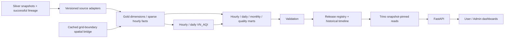

# Lớp Gold — Vietnam Air Quality Lakehouse

[Mục lục tài liệu](../README.md) / **Lakehouse**

Tài liệu mô tả implementation và kết quả kiểm chứng hiện có, đối chiếu ngày
28/10/2026. Xem [RUN.md](../operations/RUN.md) để chạy thủ công,
[SCHEMA](../../lakehouse/gold/SCHEMA.md) để tra physical fields/keys/partitions và
[RUNBOOK](../../lakehouse/gold/RUNBOOK.md) cho backfill, replay, rollback và recovery.

## 1. Vai trò và kiến trúc

Gold là lớp phân tích **được materialize trong Iceberg**, gồm dimensions/facts,
AQI results và serving marts. Spark thực hiện ETL/analytical calculations;
Trino đọc các kết quả đã publish cho FastAPI và User/Admin dashboard.

Stack hiện có: Spark3.5.4, Iceberg1.7.1 formatv2, Nessie, MinIO và Trino476.
Spark dùng `nessie.<schema>`; Trino dùng `iceberg.<schema>`. Storage của Gold ở
`s3a://lakehouse/<schema>/`, Parquet/Zstd. Supabase vẫn là operational source;
Gold chỉ đọc Silver chuẩn hóa, không bypass về Landing hoặc Supabase.

## 2. Grain chuẩn và semantics nguồn

Gold air quality luôn có hourly grain với `hour_start_utc`, độc lập cadence của
Silver. Hourly slot là khóa phân tích; một row tại slot đó không mặc nhiên là
hourly mean. Fact giữ source resolution, temporal support, spatial representation,
unit, observed time, QC, coverage và input lineage.

| Input | Cách Gold xử lý |
| --- | --- |
| CAMS instantaneous3h hiện tại | Chỉ materialize timestamps thật; missing giờ khác xuất hiện trong serving spine |
| Verified hourly mean1h tương lai | Cùng schema hourly, adapter nhận intervals/source contract và có thể tính AQI nếu đủ gates |
| Instantaneous1h/provider snapshot | Giữ đúng semantics; cadence60phút không đủ điều kiện AQI tham chiếu |
| WAQI/API Ninjas provider AQI | Lưu trong AQI facts với `aqi_origin=provider`; station và city-proxy là các series/location kind riêng, không chạy lại VN_AQI |
| WAQI daily historical | Native daily provider AQI, không chuyển thành hourly concentration |
| Climate TRACE annual/monthly | Native emissions branch, không chuyển thành concentration hoặc AQI |

Sparse concentration facts không sinh NULL observations để lấp lịch. Serving
spine lấy expected metrics/slots từ versioned contract. Khi rút hết SO₂, SO₂ vẫn
có serving rows NULL/missing, không biến mất khỏi expected scope và không thành0.
Contract fingerprint không phụ thuộc pollutant còn xuất hiện trong facts.

Lưu instants bằng UTC; daily AQI và month calendar dùng `Asia/Ho_Chi_Minh`.
Observation, collection, schedule và measurement interval là các clocks riêng.
Current concentration fact yêu cầu actual `observed_at_utc NOT NULL`; provider
không có actual clock còn bị chặn onboarding, không lấy collection time thế vào.
Kế hoạch additive nằm tại [observation-time migration](../../lakehouse/gold/OBSERVATION-TIME-MIGRATION.md).

## 3. Mô hình dữ liệu đã triển khai

DDL hiện có29definitions. Các logical grains dưới đây có thêm `release_id`,
ngoại trừ immutable spatial cache và registry/timeline metadata theo keys riêng.

| Nhóm | Bảng | Grain |
| --- | --- | --- |
| Geography | `dim_admin_unit`, `dim_geo_component`, `dim_location` | Admin version, mainland/archipelago component, province location |
| Series/metric | `dim_air_quality_series`, `dim_metric` | Dataset×location×semantic identity; pollutant×kind×unit×vertical support |
| Time/method | `dim_date`, `dim_hour`, `dim_aqi_method`, `ref_aqi_breakpoint` | Date, UTC hour slot, method version và pollutant/basis breakpoints |
| Bridges | `bridge_source_variable_metric`, `bridge_cams_region_weight` | Source variable mapping; grid cell×region×grid/boundary/method version |
| Concentration | `fact_air_quality_hourly` | Series×hour×metric, chỉ actual source records |
| Provenance | `fact_measurement_provenance` | Cùng concentration key, independent clocks/interval/source version |
| AQI components | `fact_aqi_pollutant_hourly`, `fact_aqi_pollutant_daily` | Series×hour/date×pollutant×basis×method/profile; hourly hỗ trợ `computed` và `provider` origin |
| Overall AQI | `fact_aqi_hourly`, `fact_aqi_daily` | Series×hour/date×method/profile; hourly giữ provider/scheme và source clocks riêng |
| Air-quality marts | `mart_air_quality_hourly`, `mart_air_quality_daily`, `mart_air_quality_monthly` | Long grain: series×time×pollutant |
| Source quality | `mart_source_quality_daily` | Series×VN date×pollutant |
| Publication | `gold_release`, `gold_current_release`, `gold_timeline`, `gold_timeline_current` | Chunk registry; legacy current pointer; immutable timeline; current timeline/channel |
| Native branch | `fact_waqi_station_daily_native`, `fact_emission_aggregate_native`, `fact_emission_source_native`, `mart_emission_country_period_native` | Native station/date/variable hoặc emission source/period/hierarchy, không hourly hóa |

Hourly fact/mart partitions dùng `release_id, months(hour_start_utc)`. Small
dimensions partition theo release; daily/monthly/native có partition strategy
riêng theo DDL. ETL kiểm tra logical uniqueness/null keys/FKs vì Iceberg không
tự enforce toàn bộ relational constraints. Không join long-grain AQI như sáu
quan trắc độc lập: overall AQI được lặp trong pollutant rows.

## 4. Spatial aggregation cho Việt Nam

Gold kiểm tra34root provinces, hai archipelago children thuộc đúng parents:
Hoàng Sa thuộc Đà Nẵng, Trường Sa thuộc Khánh Hòa. Quần đảo không trở thành hai
tỉnh riêng. Geography identity có boundary hashes/versioned policy.

CAMS grid cells được giao với province geometry bằng spherical equal-area
method. Bridge weights được cache theo grid/boundary/method, không tính lại
polygon intersection cho mọi timestamp. Region concentration được tính bằng
trọng số diện tích có dữ liệu; coverage có denominator là toàn vùng.

Giữ coverage, grid cells/effective cells và representation metadata. Tổng hợp
nồng độ trước rồi mới tính AQI của chuỗi vùng; không trung bình AQI của các cells
hoặc tỉnh con. Coverage cao không chứng minh độ chính xác quan trắc cao.
CAMS model level60 không được gắn nhãn station surface measurement.

## 5. VN_AQI engine

Method hiện tại là `vn-aqi-1459-2019-project-v1`, dựa trên1459/QĐ-TCMT2019,
reference PDF/checksum được lưu trong repository. Engine thuần Python tại
`spark/jobs/gold/aqi/`, được test độc lập rồi chạy qua Spark worker calculations.
Không thay breakpoint bằng US AQI hoặc QCVN.

- Sáu chất tham gia: PM2.5, PM10, CO, NO₂, SO₂, O₃. PM1, weather, AOD, column
  quantities và emissions không tham gia công thức.
- Hourly PM dùng NowCast12fixed hourly slots, giữ tuổi slot khi thiếu dữ liệu,
  có gate các giờ gần nhất; không thay NULL bằng0 hoặc lấy12records gần nhất.
- Daily AQI tính lại từ concentration statistics: PM24hmean, SO₂/NO₂/CO max1h,
  O₃ theo1h/8h và các rules của method; rolling8h đi qua midnight đúng thời gian.
- Overall AQI là max eligible sub-index, có yêu cầu PM; giữ dominant pollutants,
  ties, category/color, input count/completeness, status và missing reason.
- Daily complete gate24/24hourly means là **project policy bảo thủ**, không khẳng
  định đây là completeness threshold bắt buộc của văn bản1459.
- Phân biệt applicability `station_reference`, `model_estimate`, `area_estimate`,
  `proxy_estimate`; estimate không được bỏ eligibility bằng cách đổi nhãn nguồn.
  Provider AQI có origin riêng, không relabel thành computed VN_AQI.

Nếu thiếu eligibility, AQI là NULL với reason, không phải0/Tốt. Monthly mart
không tạo “AQI tháng” bằng AVG hourly/daily AQI. Engine và breakpoint cũ không
được thay âm thầm; method changes cần identity/version/rebuild phù hợp.

## 6. Historical timeline, correction và consistency

Mỗi release pin input/output snapshots cho scope `[start,end)`. Publish chỉ sau
validation; current historical pointer chứa manifest hoàn chỉnh được cập nhật
atomic. Reader resolve pointer một lần và dùng các snapshot mappings đó cho cả
request. Legacy single-release pointer chỉ mô tả một chunk, không toàn lịch sử.

Timeline overlay thay toàn correction scope trong compatible lane, gồm cả keys
bị xóa. Overlap không tạo duplicate; withdrawal là tombstone, không fallback
về chunk cũ. Rollback khôi phục whole validated view. Replay không tự undo một
explicit rollback. Method/unit/geography incompatibilities cần explicit lane;
không chọn tùy tiện newest release để trộn các policies.

Wire manifestv2 dictionary-encode series metadata, vẫn đọc immutablev1. Snapshot
mappings giữ inline; old manifests/IDs không bị rewrite. New cursors pin timeline,
filter signature và scope page/offset. Hourly/daily query cap16snapshot scans;
aggregates/monthly cap32. Monthly page giữ whole VN month, không split sufficient
statistics; quá32segments/tháng cần rebuild/coalesce scopes.

Late input ở giờh có thể ảnh hưởng PM tới h+11 và O₃ tới h+7. Rebuild affected
VN days/months cùng halo, không chỉ upsert records còn tồn tại. Monthly serving
compose canonical daily sums/counts, không mean các partial-month means. AQI
distribution đếm distinct logical series-days, không đếm sáu pollutant copies.

## 7. API và dashboard

| Endpoint | Mục đích |
| --- | --- |
| `/api/gold/map` | Map34provinces theo source/method/time semantics được chọn |
| `/api/gold/history` | Historical hourly/daily/monthly, filters và snapshot-pinned pagination |
| `/api/gold/history/catalog` | Published timeline và compatible series/scope metadata |
| `/api/gold/history/aqi-distribution` | Counts theo AQI category ở logical series-day grain |
| `/api/gold/history/quality` | Valid/invalid/absent/present-NULL counts và missing publication scopes |
| `/api/dashboard`, `/api/admin/dashboard` | Compatibility contracts cho User/Admin khi backend bật Gold mode |
| `/api/gold/native/emissions` | Native emissions với hierarchy/unit status rõ ràng |

Responses giữ source/series/location, observation time, unit, cadence/representation,
AQI origin/method/profile, QC, coverage và published release/timeline identity.
Unknown collection attempts/failed ingestions giữ NULL; cadence3h không tự bị
gọi ingestion failure vì thiếu các hourly slots của lịch phân tích.

### Supabase provider AQI

`spark/jobs/gold/supabase_live.py` đọc succeeded Silver rows của WAQI live hoặc
API Ninjas trong một scope ngày Việt Nam và publish channel
`provider_air_quality`. Adapter dùng chung `fact_aqi_hourly` và
`fact_aqi_pollutant_hourly`, nhưng bắt buộc giữ origin, provider, scheme,
actual/scheduled/collection clocks và location semantics.

- WAQI dùng `location_kind=station`, `spatial_representation=station_point` và
  actual observation clock; IAQI không phải concentration.
- API Ninjas dùng `location_kind=city_proxy`; actual observation clock là NULL,
  scheduled hour chỉ là snapshot slot, không phải giá trị trung bình tỉnh.
- Hai source là hai compatibility lane. Không tổng hợp hoặc lấy trung bình
  provider AQI giữa station, city-proxy và province area series.
- Hourly mart lưu pollutant provider index với unit `AQI`. Daily/monthly provider
  AQI chưa được suy diễn; quality mart chỉ thống kê coverage slot.

Concentration maps có versioned analytical color scales theo pollutant/unit/basis,
tách sáu VN_AQI category colors. No-data neutral; unsupported Gold metrics như
PM1/AOD/weather/column không hiện như đã có dữ liệu. National concentration KPI
ghi aggregation/weighting; không AVG/SUM overall AQI lặp trong long mart. YoY
so sánh compatible matched calendar/province slots.

Backend phải đặt `DASHBOARD_DATA_SOURCE=gold`; default hiện vẫn legacy Parquet.
Frontend Gold mode không tự đổi backend repository. Gold errors không tự fallback
sample. Dashboard giới hạn25.000rows/pollutant; dùng monthly hoặc paginated API
cho lịch sử dài hơn thay vì đưa cả archive vào browser.

## 8. Vận hành và kiểm chứng

Host runner `scripts/run_gold.py` hỗ trợ manual/incremental/backfill theo chunks,
default7ngày, CLI ceiling31ngày. Adapter collect guard100.000rows gồm11hhalo;
đây là bounded driver processing, chưa phải distributed normalization toàn archive.
Spark/host runners có advisory locks cho một Compose writer; không phải distributed
lock multi-host. Hai Airflow DAG đã được thêm với DockerOperator và pool một
Iceberg writer, nhưng chưa được người vận hành build/trigger nghiệm thu nên lịch
production vẫn paused; giữ host runner là đường chạy fallback hiện có.

Retention chỉ dry-run: bảo vệ registered releases, rollback timelines, current
heads, named refs và referenced source snapshots. Không chạy automatic expiry,
orphan-file cleanup hoặc xóa release history. Manifestv2 giảm metadata size nhưng
giữ mọi immutable prefix version vẫn có growthO(n²), cần archive policy sau này.

Evidence của đợt nghiệm thu/hardening28/10/2026:

| Nhóm | Kết quả và phạm vi |
| --- | --- |
| Gold unit tests |32pass, gồm provider origin/clock/fractional sub-index |
| Supabase provider integration | WAQI:27series/27overall/162pollutant; API Ninjas:34series/34overall/204pollutant; replay pass trong `gold_test_supabase`, hai source đã publish channel `gold.provider_air_quality` |
| Computed regression sau migration | Fixture1ngày:24hourly/1daily VN_AQI valid, publish pass trong `gold_test_regression` |
| CAMS thực |612sparse facts,34series; AQI giờ/ngày NULL đúng instantaneous3h eligibility; chỉ validation input |
| Hourly mean fixture |48hourly/2daily AQI hợp lệ; fixture riêng `gold_test*` |
| Benchmark34tỉnh×6chất×31ngày |2chunks16+15ngày;25.296hourly rows/pollutant,1.054daily,34monthly qua API |
| Spark optimization7ngày |Jobs290→201; process33.355→32.500s, chỉ2,6%, chưa chứng minh stable speedup |
| Timeline metadata |Simulation1.200chunks giảm manifest15,8MB→1,03MB; không tạo1.200snapshots thật |
| Real integration |Spark correction/deletion/publish recovery/rollback và FastAPI/Trino month serving pass |
| Rerun còn bị chặn |Full historical/metric-withdrawal launch bị Docker permission chặn; Chrome E2E bị sandbox socket chặn; prior pass evidence giữ riêng |

**Chưa production ready toàn hệ thống:** provider AQI path đã chạy với succeeded
Silver input thật trong namespace kiểm thử, nhưng WAQI station-admin mapping còn
unresolved và API Ninjas concentration/actual observation clock chưa đủ contract
để tính VN_AQI. Airflow runtime smoke test và full-archive/concurrent-load
benchmark vẫn chưa hoàn tất. Không coi provider AQI là computed VN_AQI.

## 9. Đọc tiếp

- [Lệnh chạy Gold thủ công](../operations/RUN.md#silver--gold).
- [Gold architecture và deployed tables](../../lakehouse/gold/README.md).
- [Physical schema/contracts](../../lakehouse/gold/SCHEMA.md).
- [Operational runbook](../../lakehouse/gold/RUNBOOK.md).
- [Validation](../../reports/gold/VALIDATION.md), [performance evidence](../../reports/gold/performance/README.md).
- [Mô tả Silver đầu vào](SILVER.md).
