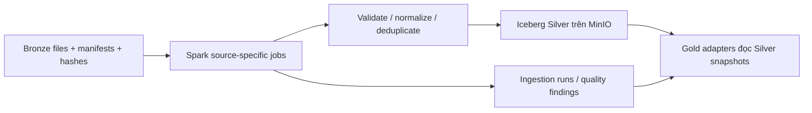

# Lớp Silver — Vietnam Air Quality Lakehouse

[Mục lục tài liệu](../README.md) / **Lakehouse**

Tài liệu mô tả implementation hiện có, đối chiếu ngày28/10/2026. Lệnh chạy từng
nguồn nằm trong [RUN.md](../operations/RUN.md); schema đầy đủ tại
[silver.sql](../../lakehouse/silver/silver.sql) và
[Silver data contracts](../../lakehouse/silver/README.md).

## 1. Vai trò và kiến trúc

Silver biến các Bronze batches đã hoàn tất thành dữ liệu có schema, semantics,
đơn vị và lineage rõ ràng. Đây là đầu vào chuẩn hóa cho Gold. Silver giữ đúng
grain native của từng nguồn; AQI engine và analytical serving thuộc Gold.

Spark sử dụng catalog `nessie.silver`; Trino đọc cùng các bảng qua
`iceberg.silver`. Dữ liệu được lưu bằng Iceberg formatv2, Parquet/Zstd trong
warehouse MinIO theo cấu hình catalog. Nessie quản lý metadata/versioning;
Iceberg không tự bảo đảm relational PK/FK, các jobs phải kiểm tra logical keys.

Supabase tiếp tục phục vụ thu thập/operational near-real-time. Các batch xuất
từ Supabase đi qua Bronze trước khi vào Silver; không dùng Supabase làm kho
phân tích Gold chính.

## 2. Nhóm bảng và grain

| Nhóm | Bảng chính | Grain và ý nghĩa |
| --- | --- | --- |
| Metadata | `dataset`, `variable` | Logical dataset/release; source variable kèm measurement kind và unit |
| Theo dõi ETL | `ingestion_run`, `data_quality_issue` | Một physical attempt; một quality finding được phát hiện |
| Hành chính | `admin_unit`, `admin_unit_source`, `admin_boundary` | Version đơn vị hành chính, mapping source và geometry có provenance |
| CAMS grid | `cams_grid`, `cams_grid_point` | Grid identity; grid×point/index và tọa độ |
| CAMS chuẩn hóa | `cams_cube_standard`, `cams_cube_standard_source` | Dataset×valid_time×grid; dataset×Bronze batch×source column |
| WAQI reference | `waqi_station`, `waqi_station_source`, `waqi_station_variable` | Trạm, source identity và expected variables |
| WAQI historical | `waqi_daily_observation` | Dataset×station×local date×variable, provider daily AQI |
| WAQI live | `waqi_hourly_observation`, `waqi_hourly_measurement` | Dataset×station×actual observation time; thêm variable cho measurements |
| API Ninjas | `province_air_quality_location`, `province_air_quality_hourly_observation`, `province_air_quality_hourly_measurement` | City proxy; dataset×proxy×snapshot hour; observation×variable |
| Climate TRACE | `emission_aggregate`, `emission_source`, `emission_source_observation` | Native aggregate/hierarchy; emission source; dataset×source×year label×variable |

`cams_cube`/`cams_cube_source` là bảng legacy chứa native values; không trộn với
`cams_cube_standard`. Một số môi trường cũ có thể còn `cams_observation` legacy;
jobs mới không tự xóa hoặc migrate dữ liệu đó.

## 3. Các jobs đã triển khai

| Job trong `spark/jobs/silver/` | Trách nhiệm |
| --- | --- |
| `common.py` | Đọc Bronze manifest/metadata, bootstrap schema, dataset/run IDs, MERGE, quality reporting |
| `admin_bronze_to_silver.py` | Chuẩn hóa hai nguồn hành chính, provenance, snapshot và boundaries |
| `waqi_bronze_to_silver.py` | Đọc historical CSV thành native daily provider AQI |
| `cams_bronze_to_silver.py` | Pipelinev4: kiểm tra20GRIB fields, chuẩn hóa theo time/grid chunks |
| `cams_physics.py` | Physical conversions, kiểm tra gas density và vertical inputs |
| `climate_trace_bronze_to_silver.py` | Annual/monthly native emissions, source types và hierarchy |
| `supabase_bronze_to_silver.py` | Adapter Bronze WAQI live/API Ninjas, provider manifests, clocks và source QC |

Các job chạy trên batch có metadata/manifests hoàn tất. Gold không tái đọc
Landing để sửa một nguồn Silver còn thiếu semantics.

## 4. CAMS EAC4: temporal, unit và vertical semantics

Mỗi `cams_cube_standard` row chứa20 `ARRAY<FLOAT>` cho một timestamp/grid.
Vị trí mảng ánh xạ theo zero-based `cams_grid_point.grid_point_id`; không được
coi một cube row là một phép đo trạm. Các trường bao gồm PM, model-level gases,
column quantities, AOD, temperature, pressure, humidity và wind.

| Quantity | Đơn vị chuẩn trong CAMS Silver |
| --- | --- |
| PM1, PM2.5, PM10 và CO/NO₂/SO₂/O₃ model level60 | `ug/m3` |
| Column quantities | `mg/m2` |
| Temperatures | `degC` |
| Pressures | `hPa` |
| Wind components | `m/s` |
| Specific humidity `q_model` | `kg/kg` |
| AOD | `1` |

Jobs kiểm tra `paramId`, source unit, grid alignment, level và step type từ GRIB
metadata. Gas concentration sử dụng density từ pressure/temperature/humidity
phù hợp; phương pháp và coefficients được giữ trong conversion metadata. Không
áp lại conversion lên standardized arrays. Column mass không tự chuyển thành
surface concentration; model level60 không phải station surface observation.

CAMS hiện tại là **instantaneous native3h**. Giữ UTC validity instants thực,
gaps và số timestamps nguồn cung cấp; không tạo hourly means bằng copy hoặc
interpolation. Một cube row có thể chứa cả Việt Nam/grid domain, nên số cube rows
không tương đương số province observations.

## 5. Semantics của các nguồn còn lại

- **WAQI historical:** ngày CSV là Vietnam-local date. Pollutant values là daily
  provider AQI, không phải concentration. Giữ cả missing values/reasons và
  expected-variable metadata; không dùng chúng để tính lại VN_AQI như nồng độ.
- **WAQI live:** giữ actual provider observation time, collection time và IAQI
  riêng theo measurement kind. Snapshot lấy theo giờ không chứng minh hourly mean.
  Nếu provider giữ nguyên observation time nhưng sửa values ở lần collection
  sau, Bronze giữ mọi raw version còn Silver canonical chọn
  `collected_at_utc` mới nhất và ghi quality warning.
- **API Ninjas:** một tọa độ city proxy, không phải spatial mean của cả tỉnh.
  Nguồn không cung cấp actual observation timestamp trong contract hiện có;
  `snapshot_hour_utc` dựa trên collection hour, không phải observation clock giả.
  Unit metadata cần được xác minh trước Gold onboarding, đặc biệt dữ liệu legacy
  có nhãn đơn vị khác provider policy; không suy hệ số từ độ lớn giá trị.
- **Climate TRACE:** giữ native annual/monthly values, periods và source types.
  Không chia annual thành hourly, không trộn emissions với ambient concentration,
  không cộng chồng totals/sectors/subsectors hoặc point-source/GADM aggregation.
  Khi input không xác nhận unit, giữ unknown thay vì tự gán tonnes.
- **Hành chính:** mã là strings để giữ số0đầu. `is_current` theo source snapshot,
  không tự coi snapshot date là ngày hiệu lực pháp lý. Reporting Gold kiểm tra
  34root provinces và hai archipelago children theo versioned policy.

## 6. Time, lineage và data quality

Spark Silver session dùng `Asia/Ho_Chi_Minh`; display và calendar partitions
cần được đọc cùng source timezone. Các trường `*_utc` và CAMS validity instants
giữ ý nghĩa UTC; không cộng/trừ7giờ thủ công. WAQI local date không bị dịch giờ.
Gold sử dụng UTC session và chuyển sang lịch Việt Nam khi tính daily AQI.

Dataset/entity IDs được tạo deterministic từ logical identity. `run_id` là
UUID của một physical attempt; `logical_run_id` nhóm retries. Provenance giữ
dataset, Bronze batch, relative source file, file SHA-256, run ID và các mapping
source/conversion tương ứng. CAMS cube truy vết qua source sidecar theo batch.

Jobs loại exact duplicates, đếm chúng và từ chối conflicting logical keys.
MERGE theo logical keys; successful logical run cùng pipeline version được skip
khi replay. Missing concentration giữ NULL với reason; zero hợp lệ giữ nguyên.

Các trạng thái ingestion gồm `running`, `succeeded`, `failed`, `partial`.
**Tồn tại rows không đủ để kết luận nguồn sẵn sàng:** một failed attempt có thể
đã commit các chunk trước khi lỗi. Consumer phải kiểm tra successful lineage;
Gold còn pin input snapshots và kiểm tra source contract trước publish.

## 7. Physical layout và vận hành

- CAMS standard cubes partition theo `year(valid_time)`; WAQI historical theo
  `year(observation_date)`; WAQI live theo `month(observation_time_utc)`.
- API Ninjas snapshots/measurements theo `month(snapshot_hour_utc)`; emissions
  theo `year(period_start)`. Small metadata/reference tables phần lớn unpartitioned.
- `data_quality_issue` partition theo ngày phát hiện. PK/FK/uniqueness phải được
  xác minh trong ETL, không suy từ DDL.
- `CREATE TABLE IF NOT EXISTS` bootstrap bảng thiếu, không tự migrate schema cũ.
  Schema evolution cần migration được kiểm tra; không ghi lại Bronze để sửa Gold.
- Chạy tuần tự writers; kiểm tra run status/quality findings sau từng nguồn.
  Commands và truy vấn kiểm tra ở [RUN.md](../operations/RUN.md).

## 8. Trạng thái dữ liệu đã được kiểm chứng

Theo evidence của đợt nghiệm thu 28/10/2026:

| Nguồn | Bằng chứng và giới hạn |
| --- | --- |
| Hành chính | Có reporting snapshot 34 tỉnh; Hoàng Sa thuộc Đà Nẵng, Trường Sa thuộc Khánh Hòa |
| CAMS | Có 3 standard cube rows thuộc `EAC4-validation-*`; chưa chứng minh EAC4 production/full archive |
| WAQI historical | Có dữ liệu Silver native phục vụ Gold provider-daily facts |
| Climate TRACE | Có dữ liệu native; certified emission units/geographic allocation vẫn thiếu |
| WAQI live/API Ninjas | Daily Supabase run ngày 28/10/2026 đã thành công qua Bronze, Silver và provider Gold; tiếp tục theo dõi coverage/QC cho các ngày kế tiếp |
| Hourly means production | Chưa có nguồn thật đủ reviewed temporal/unit/QC contract; fixtures nằm riêng `gold_test*` |

Đây là trạng thái evidence, không phải inventory tự cập nhật. Kiểm tra lại
`ingestion_run`/dataset/source metadata trước một lần vận hành mới. Không kết luận
toàn Silver production hoàn chỉnh chỉ vì các bảng đã được tạo.

## 9. Tài liệu liên quan

- [Lệnh chạy pipeline](../operations/RUN.md).
- [Silver schema và source contracts](../../lakehouse/silver/README.md).
- [Chi tiết jobs, GRIB fields và formulas](../../spark/jobs/silver/README.md).
- [Mô tả Gold và điều kiện nhận Silver](GOLD.md).
- [Báo cáo nghiệm thu và blockers](../../reports/gold/VALIDATION.md).
