# Gold layer — hourly storage, VN_AQI và serving

Cập nhật triển khai: **28/10/2026 (giờ Việt Nam)**. Có DDL, ETL Spark, AQI engine,
marts vật lý và FastAPI/Trino; đã chạy pilot dữ liệu thật và fixture 1h trên stack.
Đây chưa phải nghiệm thu full archive hoặc AQI production.

- [Schema và thay đổi so với thiết kế v2](SCHEMA.md)
- [Runbook vận hành](RUNBOOK.md)
- [Báo cáo kiểm thử](../../reports/gold/VALIDATION.md)
- [Thiết kế schema v2 lưu trữ](SCHEMA-v2-ARCHIVE.md)
- [Benchmark và giới hạn scale đã đo](../../reports/gold/performance/README.md)
- [Unknown observation clock: migration chưa kích hoạt](OBSERVATION-TIME-MIGRATION.md)

Performance hardening đã kiểm thử fixture34tỉnh ×6chất ×31ngày bằng2chunks16+15ngày;
không tăng collect guard100.000rows hoặc driver heap2GiB. Hourly serving giữ25.296
slots/pollutant,1.054series-days và34monthly values. Đây là fixture cô lập, không
phải production hourly input. Default backfill7ngày; giảm chunk nếu scope có thêm
series. Spark jobs giảm290→201 trong benchmark7ngày, nhưng runtime chỉ giảm2,6%.
Không suy từ đó rằng full archive đã được nghiệm thu.

Historical wire manifestv2 deduplicate series metadata, vẫn đọc v1 và giữ snapshot
mappings. Historical API phân batch16scans cho hourly/daily,32cho aggregates và
monthly whole-month pages; không download toàn archive để lọc/phân trang.
Snapshot inventory là dry-run fail-closed; chưa cho phép cleanup tự động.

## Trạng thái đã kiểm chứng

| Namespace | Nội dung thực tế | Giới hạn |
| --- | --- | --- |
| `nessie.silver` / `iceberg.silver` | 34 root provinces; hai đảo đúng parent; WAQI daily, Climate TRACE, 3 CAMS standard rows | CAMS chỉ thuộc `EAC4-validation-*`, không phải archive production; chưa có Silver hourly mean thật |
| `gold_pilot` | CAMS thật 2003-01-01 00/03/06 UTC: 612 phép đo, 34 series; facts AQI và marts đã materialize | Input validation, chỉ dùng pilot. AQI NULL đúng eligibility |
| `gold_test_hourly` | Fixture 48 giờ + 11 giờ halo: 48 AQI giờ, 2 AQI ngày hợp lệ | Dữ liệu kiểm thử, tuyệt đối không production |
| `gold_test_partition` | Fixture qua Jan/Feb và local midnight | Kiểm thử biên partition, không production |
| `gold`, channel `native_sources` | WAQI daily provider AQI và Climate TRACE native facts/mart | Unit phát thải chưa xác minh; GADM chưa phân bổ. Channel air_quality production chưa publish |

Không coi số snapshot Supabase là số quan trắc hợp lệ hoặc coi tồn tại DDL là Silver hoàn chỉnh.
Không thay đổi Bronze/Silver/Supabase để tạo pilot này. Compose chỉ thêm mount DDL/contracts Gold read-only.

## Kiến trúc

```mermaid
flowchart LR
  S[Silver snapshots + successful attempts] --> A[Adapter semantic contract]
  G[Silver grids + boundaries] --> W[Versioned cached intersection weights]
  A --> F[Sparse hourly concentration facts]
  W --> F
  F --> Q[Pure VN_AQI engine on Spark workers]
  Q --> X[4 AQI facts: components + overall, hourly + daily]
  F --> M[Materialized hourly/daily/monthly/quality marts]
  X --> M
  M --> V[Keys / FK / QC / scope validation]
  V --> P[Immutable release manifest + atomic pointer]
  P --> T[Trino snapshot reads]
  T --> API[FastAPI Gold + compatibility repositories]
  API --> UI[User / Admin dashboards]
```

Spark 3.5.4, Iceberg 1.7.1 format v2, Nessie main, MinIO `s3a://lakehouse/<namespace>/`;
Trino 476 dùng `iceberg.<namespace>`. Parquet/Zstd, fact/mart hourly partition
`release_id, months(hour_start_utc)`; dims nhỏ partition theo release.
Release partition phục vụ isolation/cleanup; small files vẫn phải đo trước khi mở rộng.

## Bảng MVP và grain

Mọi grain có thêm `release_id`, trừ bridge cache bất biến.

| Bảng | Grain |
| --- | --- |
| `dim_admin_unit` | Admin version; 34 roots + 2 archipelago children trong reporting snapshot |
| `dim_geo_component` | Mainland hoặc archipelago geometry thuộc province |
| `dim_location` | Province geometry version; chỉ 34 location cấp tỉnh |
| `dim_air_quality_series` | Dataset × location × semantic contract/cadence/representation |
| `dim_metric` | Pollutant × concentration/unit/vertical support |
| `bridge_source_variable_metric` | Dataset/source variable → metric |
| `dim_date`, `dim_hour` | Ngày; slot UTC `[h,h+1h)` liên tục, kể cả halo |
| `dim_aqi_method`, `ref_aqi_breakpoint` | Method version; pollutant/basis/breakpoint |
| `bridge_cams_region_weight` | Grid point × region geometry × method |
| `fact_air_quality_hourly` | Series × hour × metric; chỉ actual source samples, gồm halo |
| `fact_aqi_pollutant_hourly`, `fact_aqi_hourly` | Series × hour × pollutant/basis; series × hour |
| `fact_aqi_pollutant_daily`, `fact_aqi_daily` | Series × VN date × pollutant/basis; series × VN date |
| `mart_air_quality_hourly` | Series × hour × pollutant; serving spine cho scope đã chọn |
| `mart_air_quality_daily` | Series × VN date × pollutant |
| `mart_air_quality_monthly` | Series × local month × pollutant |
| `mart_source_quality_daily` | Series × VN date × pollutant |
| `gold_release`, `gold_current_release` | Immutable chunk registry; legacy single-chunk/native pointer |
| `gold_timeline`, `gold_timeline_current` | Immutable historical view versions; atomic full-manifest pointer/channel |
| `fact_measurement_provenance` | Release × series × hour × metric; independent clocks/interval/source version |

Native branch: `fact_waqi_station_daily_native` giữ dataset/station/date/variable và provider scheme;
`fact_emission_aggregate_native` giữ period/hierarchy/gas; `fact_emission_source_native`
giữ source/year/gas/source type; `mart_emission_country_period_native` chỉ chọn totals.
Không cộng national totals với sectors/subsectors hay point-source với GADM aggregation.

## Temporal, spatial và AQI

Gold luôn hourly dù input cadence khác nhau. CAMS instant 3h chỉ vào timestamp thật;
không resample/fill/interpolate. `hourly_mean`, resolution=60, đúng unit, vertical support,
QC và applicability là các gate riêng. Profile estimate không bỏ qua gate temporal.
Adapter normalized tương lai giữ cùng schema facts/AQI/marts; onboarding nguồn cần contract
đã review và successful Silver run IDs. Adapter MVP này dành cho concentration đã tổng hợp
về province; station/proxy ingestion cần location adapter riêng.

CAMS PM dùng model surface; bốn khí dùng model level 60, tất cả sáu nồng độ chuẩn `ug/m3`.
Không lấy column mass, PM1, IAQI, weather hay emissions làm concentration AQI.
Geo bridge dùng giao cell và polygon trên phép chiếu diện tích bằng nhau hình cầu bán kính cố định
R=6371008.8m, densify 0.025°. Cache key bao gồm grid, geometry hash, increments và method.
Province union với geometry đảo trước khi đo diện tích; mainland/component dùng difference để tránh chồng.
Nồng độ là tổng `value*intersection_fraction` / tổng phần diện tích có giá trị; coverage có denominator
là toàn province. Gate spatial 0.95 trong versioned CAMS contract. Coverage không phải accuracy quan trắc.

Method `vn-aqi-1459-2019-project-v1` pin PDF 1459 và SHA-256 trong `references/`.
NowCast 12 fixed slots, ít nhất 2/3 giờ gần nhất; đúng nhánh normalized `w>0.5` và
unnormalized `sum(0.5^i*c_i)` khi `w=0.5`. Missing không làm dịch tuổi slot; zero không chia 0.
AQI giờ max sub-index hợp lệ, bắt buộc ít nhất một PM. Ngày Việt Nam `[00:00,next 00:00)`
được biểu diễn bằng start slots; tương ứng end labels 01:00…00:00 trong PDF.
PM mean24h; SO2/NO2/CO max1h; O3 max của hai sub-index 1h/8h, bỏ basis8h nếu >400.
Rolling8h có thể bắt đầu ngày trước. Không suy AQI ngày từ AQI giờ.

Policy dự án: half-up rounding; daily 24/24 eligible means mỗi pollutant, O3 cần 24 windows8h đầy đủ.
Đây là completeness gate bảo thủ của dự án. Terminal cutoffs `>=` cho AQI500, không extrapolate;
O3 8h >400 là ineligible. Ties theo raw sub-index, category theo integer AQI; lưu cả raw/breakpoint.
PDF ví dụ NO2=118.7 in 60 nhưng công thức cho 59.35→59; test ghi rõ và theo công thức.

Daily/monthly concentration là thống kê **native samples có thật**, lưu sum/count để tránh mean-of-means;
không gọi trung bình 3 mẫu instantaneous là mean24h tham chiếu. Monthly không có AQI tháng;
chỉ distribution AQI ngày. Expected monthly hours là toàn tháng; scope chưa đầy tháng có coverage thấp.
Quality mart đo hourly measurement availability; collection attempts/failed ingestion còn NULL khi
Silver chưa có telemetry tương ứng. Không đánh đồng 16 slot thiếu của CAMS với 16 collection failures.

## Serving và phạm vi triển khai

`/api/gold/map` trả 34 tỉnh cùng một hour/source/method; default chọn latest actual timestamp chung.
`/api/gold/air-quality` trả hourly/daily/monthly; `/api/gold/source-quality`, `/api/gold/admin/summary`
phục vụ chất lượng và KPI. Native emissions dùng `/api/gold/native/emissions`.
API đọc mart đã materialize qua `FOR VERSION AS OF`; không tính lại AQI hoặc fallback sample.
API time range là start inclusive/end exclusive; daily bounds phải align midnight Việt Nam.
`/api/gold/history` tự ghép các chunk đã publish; monthly dùng sum/count của canonical daily scopes sau overlay. `/air-quality` cũ giữ single-release contract để backward compatibility.

Compatibility `/api/dashboard`, `/api/admin/dashboard` bật bằng `DASHBOARD_DATA_SOURCE=gold`;
frontend `VITE_DASHBOARD_SOURCE=gold` dùng hourly và 24 giờ trong picker. AQI không average
qua tỉnh/thời gian; national AQI card để NULL, province/hour hoặc province/day có thể hiển thị AQI đã tính.
Màu VN_AQI đủ sáu mức; metadata chỉ rõ estimates, cadence, thời gian và QC. Các component đảo
tra dữ liệu province qua parent trong bản đồ. Operational Supabase giữ luồng riêng.

Lịch sử dùng `gold_timeline_current`: một request pin một manifest đầy đủ, không đọc head thay snapshot. Correction thay cả scope; withdrawal không làm sống lại dữ liệu cũ. Chunks khác method/unit/geography/source semantics cần chọn `compatibility_id` rõ ràng. Cursor giữ timeline khi có publication đồng thời. API `/history/catalog` công khai các lane/source/series; frontend không ghép release IDs.

Frontend có thang nồng độ cố định cho sáu chất trong `contracts/concentration-colors-v1.json`: unit/statistic/version/note rõ ràng, không phải breakpoint AQI/QCVN hoặc quantile động. AQI vẫn sáu mức VN_AQI. Admin có sample-weighted KPI, source-quality và daily AQI category distribution; counts theo series-day, không theo pollutant-row. Missing scope và QC không bị đổi thành zero.

Nguồn production vẫn bị chặn bởi thiếu full EAC4/hourly-mean Silver. Station/proxy transforms và fixtures đã có, nhưng chưa có production adapter activation; Ninjas cần unit certification và migration cho unknown observation time, WAQI cần verified station mapping. `api-ninjas-unit-review.json` ghi bằng chứng provider và quy trình không nhân sai đơn vị. Emission units/GADM allocation, collection telemetry và Airflow submit transport vẫn chưa sẵn sàng.

Host runner giữ single writer và 1–31 local days/release. Driver collection có budget 100.000 rows, vượt thì giảm chunk; chưa thay bằng distributed streaming toàn archive. Dry-run retention bảo vệ mọi registry/rollback snapshot, cleanup bị tắt; storage growth và multi-host locking còn cần đánh giá trước production. Xem [runbook](RUNBOOK.md) và [validation](../../reports/gold/VALIDATION.md) cho bằng chứng/giới hạn.

PM1/AOD/weather/column metrics có lựa chọn ở frontend legacy nhưng chưa được onboard vào Gold sáu-chất. Chúng cần measurement-kind/vertical/unit và aggregation riêng (đặc biệt wind/vector/column), không đưa vào AQI. Việc mở rộng này được deferred để không trộn đại lượng sai hoặc phá MVP concentration/AQI.

`normalized-hourly-v3.json` khai báo đầy đủ metric/unit/vertical policy. Xóa hết SO₂ không đổi compatibility và vẫn có SO₂ NULL/missing trong serving spine, không tạo concentration fact giả. Metadata sai unit/vertical bị chặn publish; đây là negative test bắt buộc. Dashboard trả QC/observation time theo từng pollutant; threshold metadata chỉ lấy từ đúng contract hash, không mặc định 0.95 cho mọi nguồn.

YoY PM2.5 chỉ so sánh các cặp province/calendar-slot cùng có giá trị hợp lệ ở cả hai năm; daily/hourly Feb29 không tái sử dụng baseline Feb28. Daily/monthly Gold dùng calendar `Asia/Ho_Chi_Minh` trong UI và CSV; hourly labels luôn UTC. Wide dashboard snapshot có QC summary và `metricQuality` từng pollutant, không lấy QC/coverage của pollutant cuối để mô tả cả snapshot.
