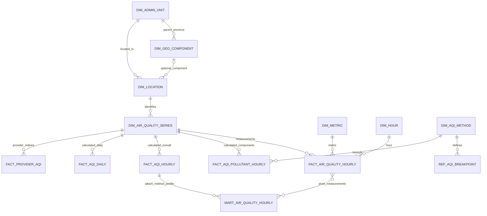

> Archived design/history. This document is not the deployed schema. See [SCHEMA.md](SCHEMA.md) and [gold.sql](gold.sql) for the current contract.

# Thiết kế schema Gold: hourly và AQI

Thiết kế gốc **v2**, ngày 27/10/2026; cập nhật implementation 28/10/2026. DDL thực thi là [gold.sql](gold.sql), workflow và phạm vi đã kiểm chứng xem [README](README.md). Phần v2 bên dưới giữ làm thiết kế đích; các khác biệt vật lý đã triển khai được ghi ngay sau đây.


## Hợp đồng vật lý MVP đã triển khai (ưu tiên khi đọc phần v2)

- `gold.sql` là Spark/Iceberg DDL, namespace template `{{schema}}` chỉ thay bằng identifier đã validate.
  Namespace là logical container; không dựa default-location của namespace để suy physical layout (khác đề xuất namespace LOCATION trong v2).
  Vị trí table explicit `s3a://lakehouse/<schema>/<table>`. Trino `iceberg.<schema>` đọc cùng Nessie main.
- Các tables release có `release_id STRING NOT NULL`, kể cả dims/hour spine. Logical keys trong thiết kế
  v2 đều có thêm release_id. Một release pin đúng một method/profile cho mỗi series; phiên bản mới tạo release mới.
- MVP `dim_admin_unit`: 34 root provinces và hai child 20333/22736, không copy toàn bộ 3.355 wards.
  `dim_geo_component`: 34 mainland và hai archipelago geometry; `dim_location`: 34 full-province geometry versions.
  Location ID có boundary hash; series ID có dataset, location, contract hash, resolution, temporal/spatial semantics.
- `dim_metric`: sáu concentration pollutants, unit `ug/m3`, vertical_support riêng (PM model_surface;
  gases model_level_60). Các weather/column metrics, station/proxy dimensions và bridges là thiết kế mở rộng.
- Geography hierarchy/mapping lấy từ versioned contract `reporting-geography-v1.json`; resolved contract nằm trong release identity.
- Hour fact sparse: `(release_id,series_id,hour_start_utc,metric_id)`; field actual `value`, `unit`,
  `observed_at_utc`, `source_resolution_minutes`, `temporal_support`, `spatial_representation`,
  `vertical_support`, `reference_eligible`, `source_dataset`, `quality_status`, `missing_reason`,
  `spatial_coverage_ratio`, `grid_cells`, `effective_cells`, `input_run_ids ARRAY<STRING>`,
  `input_snapshot_id BIGINT`. Giá trị QC bị từ chối được đặt NULL với reason trước analytical statistics; giá trị nguồn vẫn truy qua Silver snapshot. Có halo input 11h, output serving chỉ trong release scope.
- `bridge_cams_region_weight` là immutable cache KHÔNG có release_id. Key gồm cache_key/grid_point/location;
  cache_key hash grid/boundary/method/increments. Fields intersection_area_m2, region_area_m2, area_fraction,
  latitude_increment, longitude_increment. Release manifest pin cache table snapshot đã dùng.
- AQI component tables lưu pollutant/basis/concentration/raw_index/sub_index, BP low/high và I low/high,
  window_start/end, input_count/expected_count/completeness/weight, status/missing_reason,
  method_version/applicability_profile và input_lineage_json chứa Silver snapshots + contract hash.
  Overall lưu aqi, dominant_pollutants, category/label/color và status; completeness từng cửa sổ truy qua component facts.
  Time field là hour_start_utc hoặc aqi_date_local. Daily O3 có hai component basis; mart daily chặn selected
  O3 sub-index khi không đủ 24 complete rolling windows; component raw 1h vẫn giữ để kiểm tra.
- Marts MVP là **long grain** `(release_id,series_id,time,pollutant)` thay wide row v2. Một method/profile
  pin trong release. Overall AQI lặp có chủ đích trên sáu pollutant rows: tuyệt đối không SUM nó;
  khi tính distribution qua nhiều pollutant, phải dedup series/date hoặc chọn một pollutant.
  API compatibility pivot sáu rows thành một province/time, không nhân số dòng khi join facts.
- Hour mart thêm spine phục vụ scope chọn; NULL value có `no_source_observation`. Fact không sinh skeleton NULL.
  Daily concentration value là sample mean có sum/count/min/max, valid_hours/missing_hours/expected_hours=24;
  `aggregation_policy=available_native_samples_v1_calendar_vn`. Nó chỉ là mean24h AQI input khi đủ eligibility.
- Monthly value là sum(concentration_sum)/sum(valid_hours), expected_hours là số ngày toàn tháng×24;
  `valid_days` đếm ngày có đủ 24 sample slots, `aqi_valid_days` chỉ ngày tính AQI; `aqi_category_counts`
  là MAP<STRING,BIGINT>. Scope partial-month được giữ rõ trong release. Không có field AQI tháng.
- Quality mart có measurement coverage, latest observed time, cadence/temporal support;
  collection_attempts/failed_ingestions hiện NULL với quality_scope rõ. Không tự thay bằng zero.
- Provider historical ở `fact_waqi_station_daily_native`: provider_aqi, origin=provider,
  scheme=provider_unspecified; không gắn VN_AQI method. Hai native emission facts giữ đơn vị NULL/unverified,
  source_type và mapping_status riêng; country period mart chỉ totals. Không gộp hierarchy/source types/gases.
- Publication rút gọn từ 5 metadata tables v2 thành `gold_release` + `gold_current_release`.
  Registry giữ scope UTC, input/output snapshot JSON, contract/code hash, method, published_at, validation counts.
  Pointer chứa release và nguyên snapshot mapping, commit Iceberg một lần. Không cần transaction xuyên table
  bởi reader time-travel tất cả tables theo manifest. Failure/recovery/rollback đã được test trên stack thật.
  Code hash bao gồm Python jobs + DDL; scope/inputs/contract/method cũng nằm trong release identity.
- Bootstrap chỉ CREATE IF NOT EXISTS, không tự thay schema đã có. Thay đổi vật lý sau MVP phải có migration riêng.
  Release/snapshot retention và một writer là điều kiện vận hành, không phải FK/unique constraints do Iceberg enforce.

Các thay đổi này giảm publication metadata và pivot dư thừa, vẫn giữ hourly grain cùng khả năng backfill
nguồn 1h; không yêu cầu đổi cấu trúc facts/AQI/marts khi thay cadence. Chưa có composite multi-chunk
release; API chỉ đọc một scope có thể kiểm chứng, thay vì công bố giả một lịch sử hoàn chỉnh.

## 1. Grain, identity và quan hệ

- Chất lượng không khí: mặc định **1 giờ**, khóa UTC `hour_start_utc`; mỗi slot là `[hour_start_utc, hour_start_utc + 1h)`.
- `series_id` tách dataset/source contract, location, cadence, spatial/temporal policy. Mỗi nguồn có series riêng dù cùng tỉnh và giờ; không gộp WAQI, CAMS, API Ninjas thành một số đo.
- Các ID entity/fact/series là SHA-256 deterministic theo namespace/version và logical key; `gold_build_id` là physical attempt UUID. Logical build hash và published release được quản lý riêng.
- SQL types dưới đây theo Spark/Iceberg: `STRING`, `TIMESTAMP`, `DATE`, `INT`, `DOUBLE`, `BOOLEAN`, `ARRAY<STRING>`, `MAP<STRING,STRING>`. Timestamp mang ý nghĩa UTC instant; Spark session timezone chỉ đổi hiển thị.
- Lưu `DOUBLE` cho nồng độ/kết quả chưa làm tròn và `INT` cho AQI hiển thị. Không làm tròn concentration trước tính toán nếu method không yêu cầu. Mọi PK/FK là logical constraints do job kiểm tra.



Sơ đồ là quan hệ logic, không phải Iceberg constraints. Mart có thêm method/profile trong grain nên có thể có nhiều bản ghi cho một series/hour; API luôn chọn method/profile đã pin trong release.

## 2. Địa lý: sửa 36 entry thành hierarchy 34 tỉnh

| Bảng | Logical key | Fields chính |
| --- | --- | --- |
| `dim_admin_unit` | `admin_unit_version_id STRING` | `admin_code STRING`, `name_vi STRING`, `parent_admin_unit_version_id STRING?`, `admin_level INT`, `unit_type STRING`, `snapshot_date DATE`, `valid_from/valid_to DATE?`, `is_current BOOLEAN`, `boundary_hash STRING?` |
| `dim_geo_component` | `geo_component_id STRING` | `parent_admin_unit_version_id STRING`, `component_name STRING`, `component_kind STRING`, `source_admin_unit_version_id STRING?`, `boundary_id STRING`, `geometry_hash STRING`, `area_m2 DOUBLE`, `geography_policy_version STRING` |
| `dim_location` | `location_id STRING` | `location_kind STRING`, `admin_unit_version_id STRING?`, `geo_component_id STRING?`, `station_id STRING?`, `proxy_location_id STRING?`, `name STRING`, `latitude/longitude DOUBLE?`, `spatial_representation STRING`, `mapping_status STRING`, `mapping_method STRING?` |

`dim_admin_unit` giữ được cả cấp dưới từ Silver; count **root province của snapshot chọn = 34**. Nếu quần đảo có record hành chính nguồn, giữ đúng level/parent đã kiểm chứng; không tạo thêm root province. `dim_geo_component` chỉ phân tách geometry, không tự khẳng định cấp hành chính pháp lý.

Mapping theo bộ dữ liệu của project:

| Component | Parent tỉnh/thành | Mã parent trong dữ liệu hiện có | Vai trò |
| --- | --- | --- | --- |
| Hoàng Sa, source code `20333` | Đà Nẵng | `48` | Archipelago child, phục vụ geometry/drill-down |
| Trường Sa, source code `22736` | Khánh Hòa | `56` | Archipelago child, phục vụ geometry/drill-down |

Mã/version lấy từ registry đã kiểm chứng khi build, không hardcode tên làm key. API province list/ranking chỉ query root province. Parent concentration tính theo diện tích hợp lệ của toàn polygon hoặc các phần con không chồng lặp; giữ denominator đầy đủ cả quần đảo. AQI parent tính lại từ concentration parent, không average/max AQI các child rồi coi là AQI parent.

## 3. Dimensions thời gian, series và metric

| Bảng | Logical key | Fields chính |
| --- | --- | --- |
| `dim_hour` | `hour_start_utc TIMESTAMP` | `hour_end_utc TIMESTAMP`, `date_utc DATE`, `date_vn DATE`, `hour_vn INT`, `timezone_vn STRING` |
| `dim_date` | `calendar_date DATE` | `year/month/day INT`, `days_in_month INT`, `is_leap_year BOOLEAN` |
| `dim_air_quality_series` | `series_id STRING` | `dataset_id STRING`, `location_id STRING`, `source_system STRING`, `source_contract_version STRING`, `source_resolution_minutes INT`, `source_temporal_support STRING`, `spatial_policy_version STRING`, `temporal_policy_version STRING`, `geography_policy_version STRING`, `active_from/to TIMESTAMP?`, `metadata_status STRING` |
| `dim_metric` | `metric_id STRING` | `canonical_name STRING`, `measurement_kind STRING`, `standard_unit STRING?`, `physical_quantity STRING`, `vertical_support STRING?`, `aqi_eligible BOOLEAN`, `unit_policy_version STRING` |
| `bridge_source_variable_metric` | dataset, source variable, metric policy | `dataset_id`, `variable_id`, `metric_id`, `metric_policy_version`, `conversion_method`, `conversion_metadata`, `source_unit`, `standard_unit`, `unit_verified BOOLEAN` |

`location_kind`: `province`, `geo_component`, `station`, `city_proxy`. Province đầy đủ và mainland-only là location khác nhau. `measurement_kind` tách concentration, weather, column mass, provider index, emission quantity. Alias PM2.5 nguồn `pm2p5`/`pm25`/`pm2_5` map qua registry; không chỉ chuẩn hóa tên rồi bỏ semantics.

`source_temporal_support`: `hourly_mean`, `instantaneous`, `provider_snapshot`, `unknown`. Chỉ có `source_resolution_minutes=60` chưa đủ để suy `hourly_mean`.

## 4. AQI method và breakpoint reference

### `dim_aqi_method`

Key: `method_version STRING`. Fields:

```text
scheme_code STRING                         -- VN_AQI
reference_document STRING                  -- 1459/QĐ-TCMT, 12/11/2019
reference_url STRING
reference_sha256 STRING
implementation_version STRING
calculation_policy_version STRING
concentration_unit STRING                  -- ug/m3
calendar_timezone STRING                   -- Asia/Ho_Chi_Minh
nowcast_policy STRING                      -- 12 fixed hourly slots, exact PDF branches
rounding_policy STRING                     -- recorded decimal half-up policy
terminal_range_policy STRING
hourly_eligibility_policy STRING
daily_completeness_policy STRING
supported_profiles ARRAY<STRING>
created_at TIMESTAMP
```

Method version là contract bất biến. Đổi formula/breakpoint/rounding/coverage tạo version mới và recompute dependency scope; không sửa âm thầm kết quả release cũ.

### `ref_aqi_breakpoint`

Key: `(method_version, pollutant, averaging_basis, breakpoint_order)`.

```text
method_version STRING
pollutant STRING                           -- pm25, pm10, co, no2, so2, o3
averaging_basis STRING                     -- nowcast12h, mean1h, mean24h, max1h, max8h
breakpoint_order INT
concentration_breakpoint DOUBLE
index_breakpoint INT
is_terminal_cutoff BOOLEAN
reference_table STRING
```

Seed theo bảng 2 của [hướng dẫn gốc](https://vea.mae.gov.vn/Data/files/QD%201459%20TCMT%20ngay%2012_11_2019%20AQI%281%29.pdf), đơn vị µg/m³:

| I | O3 1h | O3 8h | CO | SO2 | NO2 | PM10 | PM2.5 |
| --- | --- | --- | --- | --- | --- | --- | --- |
| 0 | 0 | 0 | 0 | 0 | 0 | 0 | 0 |
| 50 | 160 | 100 | 10000 | 125 | 100 | 50 | 25 |
| 100 | 200 | 120 | 30000 | 350 | 200 | 150 | 50 |
| 150 | 300 | 170 | 45000 | 550 | 700 | 250 | 80 |
| 200 | 400 | 210 | 60000 | 800 | 1200 | 350 | 150 |
| 300 | 800 | 400 | 90000 | 1600 | 2350 | 420 | 250 |
| 400 | 1000 | — | 120000 | 2100 | 3100 | 500 | 350 |
| 500 | ≥1200 | — | ≥150000 | ≥2630 | ≥3850 | ≥600 | ≥500 |

Không insert dấu `≥` thành string concentration: lưu numeric cutoff và `is_terminal_cutoff=true`. Không tạo rows O3 8h cho miền bảng không quy định; daily O3 xử lý max1h/max8h và giới hạn 8h theo method. Dùng chung concentration breakpoints đúng chất nhưng phân biệt averaging basis để tránh lấy instant PM làm NowCast.

## 5. Các fact cần materialize

### `fact_air_quality_hourly`

Key: `(series_id, hour_start_utc, metric_id)`; `measurement_id` hash key. Partition: `month(hour_start_utc)`.

```text
measurement_id STRING
series_id STRING
hour_start_utc TIMESTAMP
metric_id STRING
observed_at_utc TIMESTAMP?                  -- source observation time nếu biết
measurement_start_utc TIMESTAMP?            -- interval đo thực, không suy từ slot
measurement_end_utc TIMESTAMP?
collected_at_utc TIMESTAMP?
value_native DOUBLE?
value_standard DOUBLE?
temporal_support STRING
source_resolution_minutes INT
source_sample_count INT
expected_source_sample_count INT?
hourly_mean_eligible BOOLEAN
spatial_coverage DOUBLE?
qc_flag STRING
missing_reason STRING?
source_variable_id STRING?
source_ingestion_run_ids ARRAY<STRING>
input_snapshot_fingerprint STRING
gold_build_id STRING
loaded_at TIMESTAMP
```

Metric/statistic là một contract duy nhất trong mỗi series. Muốn giữ cả instantaneous và mean1h cho cùng nguồn/địa điểm phải dùng series/temporal policy khác, tránh hai phép đo chiếm cùng key. Slot thiếu có giá trị NULL, reason và source lineage/scope phù hợp. CAMS 3h có `hourly_mean_eligible=false`; không nhân bản giá trị để lấp slot.

### `fact_provider_aqi`

Key: `(series_id, provider_observation_key, pollutant_or_overall, provider_scheme)`.

Fields: provider observation identity, series/location, source observation time nullable, scheduled/collected time, optional associated slot, source period type (`event/hour/day`), pollutant hoặc `overall`, raw provider index, provider scheme (unknown phải ghi unknown), validation status, Silver/Bronze lineage, build ID. Native daily provider AQI giữ DATE/period gốc; collection hour không được thay observation hour khi provider không cung cấp.

### `fact_aqi_pollutant_hourly`

Key: `(series_id, hour_start_utc, pollutant, method_version, applicability_profile)`; `aqi_component_id` hash key. Partition: `month(hour_start_utc)`.

```text
aqi_component_id STRING
series_id STRING
hour_start_utc TIMESTAMP
pollutant STRING
method_version STRING
applicability_profile STRING                -- station_reference, model_estimate, area_estimate, proxy_estimate
concentration_basis STRING                  -- mean1h, nowcast12h; estimate ghi rõ khác biệt
concentration_used DOUBLE?
concentration_unit STRING                   -- ug/m3
window_start_utc TIMESTAMP
window_end_utc TIMESTAMP
valid_hour_count INT
expected_hour_count INT
recent_three_valid_count INT?
valid_slot_mask STRING?                     -- fixed ages, 12 slots cho PM
nowcast_weight DOUBLE?
breakpoint_lo_order INT?
breakpoint_hi_order INT?
aqi_raw DOUBLE?
aqi_rounded INT?
is_saturated BOOLEAN
calculation_status STRING
missing_reason STRING?
input_snapshot_fingerprint STRING
input_measurement_ids ARRAY<STRING>
gold_build_id STRING
calculated_at TIMESTAMP
```

`input_measurement_ids` là các input tham gia và candidate scope để tái lập window; current snapshot fingerprint pin tập bảng đọc. Dữ liệu lớn có thể chuyển lineage này thành bảng bridge với `aqi_component_id, measurement_id, role, contribution_weight`; vẫn giữ window/mask trên component.

### `fact_aqi_hourly`

Key: `(series_id, hour_start_utc, method_version, applicability_profile)`; `aqi_result_id` hash key. Partition: `month(hour_start_utc)`.

```text
aqi_result_id STRING
series_id STRING
hour_start_utc TIMESTAMP
method_version STRING
applicability_profile STRING
aqi_origin STRING                          -- calculated
overall_aqi_raw DOUBLE?
overall_aqi INT?
dominant_pollutants ARRAY<STRING>            -- lưu mọi chất đồng max
available_pollutants ARRAY<STRING>
missing_pollutants ARRAY<STRING>
valid_pollutant_count INT
has_valid_required_pm BOOLEAN
category_code STRING?
category_label_vi STRING?
color_hex STRING?
calculation_status STRING
missing_reasons MAP<STRING,STRING>
input_component_ids ARRAY<STRING>
input_snapshot_fingerprint STRING
gold_build_id STRING
calculated_at TIMESTAMP
```

Các trạng thái: `calculated`, `partial_pollutants`, `insufficient_history`, `missing_required_pm`, `ineligible_temporal_support`, `invalid_input`, `not_available`. Không áp default `overall_aqi=0` khi không tính được. Dominant được xác định trước rounding và lưu cả tie rule trong method.

### `fact_aqi_pollutant_daily` và `fact_aqi_daily`

- Component key: `(series_id, aqi_date_local, pollutant, concentration_basis, method_version, applicability_profile)`.
- Overall key: `(series_id, aqi_date_local, method_version, applicability_profile)`.
- Partition `year(aqi_date_local)`; thêm `calendar_timezone`, `day_start_utc`, `day_end_utc`, valid/expected hours, day completeness, window bounds và lineage. Các field index/status tương ứng fact hourly.
- PM: mean24h; khí: max1h; O3 lưu **hai component basis** max1h và max8h trước khi chọn sub-index O3 ngày. Mỗi window mean8h có hour-end rõ và có thể bắt đầu ở ngày trước.
- Ngày AQI dùng local date của interval, với nhãn cuối giờ 01:00…00:00 hôm sau. Không dùng `DATE(hour_end)` ngây thơ làm giờ cuối ngày rơi vào hôm sau.

## 6. Mart lưu AQI cùng các chỉ số chất lượng không khí

### `mart_air_quality_hourly`

Key: `(series_id, hour_start_utc, method_version, applicability_profile)`; partition `month(hour_start_utc)`.

```text
series_id, dataset_id, location_id, admin_unit_version_id STRING
geo_component_id STRING?
location_kind, spatial_representation STRING
hour_start_utc, hour_end_utc TIMESTAMP
date_vn DATE
source_resolution_minutes INT
temporal_support STRING
pm25_ug_m3, pm10_ug_m3, co_ug_m3, no2_ug_m3, so2_ug_m3, o3_ug_m3 DOUBLE?
pm1_ug_m3, aod550, t2m_deg_c, d2m_deg_c, sp_hpa, mslp_hpa DOUBLE?
u10_m_s, v10_m_s DOUBLE?
co_column_mg_m2, no2_column_mg_m2, so2_column_mg_m2, o3_column_mg_m2 DOUBLE?
other_metrics MAP<STRING,DOUBLE>
metric_quality MAP<STRING,STRING>
metric_missing_reasons MAP<STRING,STRING>
aqi_pm25, aqi_pm10, aqi_co, aqi_no2, aqi_so2, aqi_o3 INT?
overall_aqi INT?
dominant_pollutants ARRAY<STRING>
aqi_method_version, applicability_profile, aqi_calculation_status STRING
aqi_category_code, aqi_category_label_vi, aqi_color_hex STRING?
provider_overall_aqi INT?                    -- chỉ attach khi khớp identity/slot semantics
provider_aqi_scheme STRING?
provider_aqi_observed_at_utc TIMESTAMP?
measurement_observed_at_utc TIMESTAMP?
collected_at_utc TIMESTAMP?
measurement_age_seconds BIGINT?
spatial_coverage DOUBLE?
available_pollutants ARRAY<STRING>
gold_build_id STRING
```

Danh sách wide là contract phục vụ API; fact long vẫn là nguồn chuẩn để bổ sung biến. `other_metrics` chứa các biến như `q_model`/`t_model` với unit/quantity lấy từ metric registry. Nồng độ thật có thể tồn tại khi AQI NULL, và provider AQI có thể tồn tại khi không đủ nồng độ để Gold tự tính. Không thay thế hai field AQI cho nhau ngầm.

Mart không ghi `published_release_id` giả vào mọi row cũ: backend trả release ID đã resolve từ `gold_current_release` và mapping snapshot dùng đọc mart. Như vậy release mới có thể tham chiếu snapshot không đổi mà không phải rewrite toàn bộ lịch sử.

### Daily, monthly, emissions và quality

- `mart_air_quality_daily`: concentration sum/count/mean/min/max, hourly coverage, AQI ngày đã tính và QC. Key có calendar timezone; chỉ attach VN_AQI ngày với đúng lịch VN.
- `mart_air_quality_monthly`: concentration sum/count, valid/expected days/hours, số ngày theo category AQI; phần phân bố AQI có method/profile trong key, không trộn phiên bản. Không tạo AQI tháng chuẩn bằng average hourly AQI.
- Emission facts/marts giữ grain source/country/province × gas × period/hierarchy, source type và allocation method. Không expand annual/monthly thành hourly.
- `mart_source_quality_daily` lấy collection counters từ manifests và measurement coverage từ Gold; không lấy số logical observations đã dedup làm số lượt thu thập.

## 7. Lineage, publish và validation schema

Thêm `gold_build_run`, `gold_build_input`, `gold_release`, `gold_release_table`, `gold_current_release`. Lưu input/output table snapshot IDs, method/unit/geography/temporal versions, attempt status, row counts, affected scope. Một API request pin một release và đọc mọi bảng qua snapshot mapping; bảo vệ snapshot khỏi cleanup khi release còn sử dụng.

Các invariant phải có trong ETL:

1. Province roots của snapshot chọn đúng 34; hai quần đảo có đúng parent, không xuất hiện trong province-only query.
2. Hourly key unique, đúng UTC hour boundary, hour_end=start+1h; series location/source contract có thật.
3. `value_standard` NULL có missing reason; zero hợp lệ giữ nguyên; source3h không tự được gắn eligible mean1h.
4. AQI computed có method/profile và input components; có overall hợp lệ thì phải có PM sub-index hợp lệ.
5. Index integer/category thống nhất; màu/nhãn đủ sáu mức; provider index không tự mang method VN_AQI.
6. Window không nhảy qua giờ thiếu, không trộn series; lineage tái lập được input và breakpoint đã dùng.
7. Mart nồng độ/sub-index/overall khớp các fact cùng snapshot/release; parent/child không double count.

Triển khai DDL và migration theo contract này trong giai đoạn Foundation; thay đổi contract phải cập nhật cả kế hoạch, DDL, ETL, API và kiểm thử.
